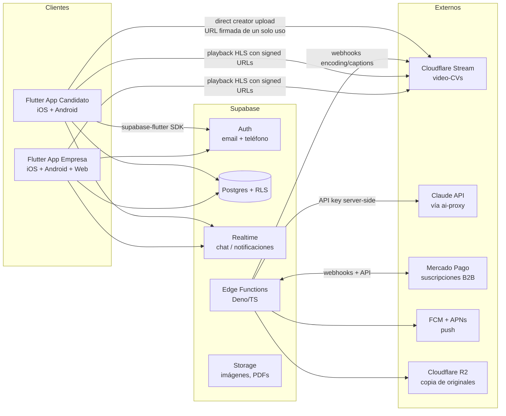
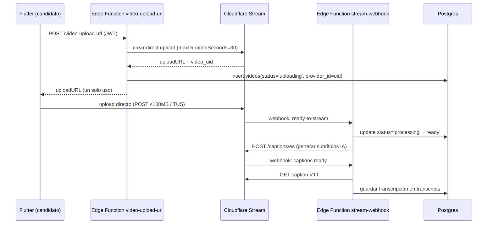

# TalentFlash — Arquitectura Técnica

**Última actualización:** 2026-09-02
**Estado:** propuesta inicial — pendiente de aprobación del fundador

Documentos relacionados: el SPEC (brief de producto compartido, fuente de verdad; §11 estructura de carpetas), `DATA_MODEL.md` (modelo de datos y políticas RLS completas), `PRODUCT.md` (planes B2B y modelo económico), `COST_DECISIONS.md` (decisiones económicas aprobadas y proyección de costos de infraestructura), `SECURITY.md` (controles, límites de upload), `PRIVACY.md` (retención y consentimientos), `ROADMAP.md` (fases de entrega).

---

## 1. Diagrama de alto nivel



Principios rectores:

1. **El cliente Flutter nunca habla directo con servicios pagos por API key** (Claude, MP, Stream management API). Todo pasa por Edge Functions.
2. **RLS de Postgres es la única capa de autorización.** No hay lógica de permisos duplicada en el cliente ni en las funciones (ver §3.2).
3. **El video pesado nunca toca Supabase**: sube directo a Cloudflare Stream y se reproduce desde su CDN. El egress de Supabase queda reservado a API, imágenes y thumbnails (excedente USD 0.09/GB por encima de 250 GB — [supabase.com/pricing](https://supabase.com/pricing), verificado 2026-08-12).
4. **Cada dependencia externa está detrás de una interfaz propia** para poder swapearla (ver §11).

---

## 2. Estructura Flutter por features

Estructura según el SPEC §11 (`core` / `features` / `shared`), monorepo con dos entry points (`main_candidato.dart`, `main_empresa.dart`) que comparten el 90% del código:

```
lib/
├── core/
│   ├── config/            # entornos dev/staging/prod, flavors
│   ├── localization/      # ARB es-AR base (ver §8)
│   ├── networking/        # cliente Supabase único, interceptores, mapeo de errores + Sentry
│   ├── routing/           # GoRouter + guards
│   ├── security/          # secure storage de tokens/sesión, validación de deep links
│   └── theme/
├── features/
│   ├── authentication/
│   ├── onboarding/        # flujos diferenciados candidato/empresa
│   ├── profiles/          # perfil candidato + CV estructurado
│   ├── companies/         # perfil de empresa, verificación CUIT
│   ├── videos/            # video-CV: grabación, upload, estados
│   ├── jobs/              # avisos: alta, listado
│   ├── discovery/         # búsqueda, filtros, feed de ofertas y feed de candidatos
│   ├── applications/      # postulaciones y pipeline de selección
│   ├── matches/           # match recíproco
│   ├── chat/              # Realtime
│   ├── billing/           # suscripciones MP (solo app empresa/web)
│   ├── notifications/
│   ├── moderation/        # denuncias, bloqueos, cola de moderación (admin)
│   ├── ai_assist/         # (adición propuesta) guiones, mejoras de texto (vía ai-proxy)
│   └── settings/          # (adición propuesta) export de datos, baja de cuenta
└── shared/
    ├── widgets/
    ├── models/            # DTOs generados desde el esquema de Supabase
    └── utils/
```

Mapeo respecto del SPEC §11: `core` y las 13 features del SPEC se adoptan con sus nombres exactos (el cliente Supabase, interceptores y mapeo de errores + Sentry viven en `networking/`). Las únicas dos carpetas que el SPEC no lista son `ai_assist` y `settings` (adiciones propuestas, requieren visto bueno del fundador); si se prefiere atenerse al SPEC estricto, `ai_assist` se absorbe en `shared/` y `settings` en `profiles/`.

Convenciones por feature (obligatorias, se validan en code review):

- **Riverpod**: cada feature expone sus providers en `features/<x>/providers/`. Estado asíncrono con `AsyncNotifier`/`AsyncNotifierProvider`; nada de `StateProvider` para lógica de negocio.
- **Repositorios**: la única clase que toca el SDK de Supabase es `<Feature>Repository` (`features/<x>/data/`). Los notifiers dependen del repositorio por interfaz abstracta — esto es también la palanca de salida de Supabase (§11).
- **GoRouter** con una única política de redirección en `core/routing/`, implementada como función pura `resolveAuthRedirect(status, entryPoint, location, onboarding)` (`auth_redirect.dart`) para poder probar cada regla sin widgets:
  - sesión sin resolver → `/inicio` (pantalla de carga), recordando el destino;
  - sin sesión → `/auth/login` con `destino` de vuelta post-login (el `destino` se sanea: solo rutas internas, nunca una URL externa);
  - con sesión, el rol del claim decide el shell: una empresa no entra a rutas de candidato y viceversa (vuelve al propio, `UX_FLOWS.md` §1.5), un intento contra `/admin` sin serlo responde con negativa explícita, y un `admin` nunca se degrada a otro shell;
  - claim ausente o inválido → `/sesion-invalida`, estado seguro sin rol asumido;
  - **gate de onboarding (Bloque C):** el estado viene de la base (`OnboardingResolution`: sin resolver / listo / no aplica) — mientras se resuelve, pantalla de carga; con onboarding incompleto, el wizard del rol es el único destino; con un consentimiento obligatorio de versión vieja, la pantalla de reconsentimiento; completo, wizard y reconsentimiento redirigen al shell. Las rutas `/legal/*` quedan siempre alcanzables y admin nunca pasa por onboarding.
  El guard es UX, no seguridad: la seguridad real es RLS.
- El catálogo de rutas vive en `core/routing/app_routes.dart` (`AppRoute`: nombre, path y rol requerido). Se navega siempre por nombre. Desde el Bloque D el catálogo admite **rutas con parámetro** (`/empresa/candidatos/:id`, la primera): `AppRoute.forPath` matchea patrones por segmentos, y la política de redirección evalúa esas rutas igual que las estáticas (mismo orden de guards).
- Cada feature tiene tests de notifier (con repositorio mockeado) y golden tests de sus pantallas principales.

#### Capa de autenticación (Bloque B)

```
lib/features/authentication/
├── domain/       # BusinessRole, AuthenticatedUser, AuthStatus (sealed),
│                 # AuthFailure (errores tipados), AuthValidation (reglas puras)
├── data/         # AuthRepository (interfaz) + SupabaseAuthRepository (GoTrue)
├── providers/    # authStatusProvider (Notifier sobre el stream del repo),
│                 # currentAuthUserProvider, businessRoleProvider,
│                 # authControllerProvider (AsyncNotifier: signUp/signIn/
│                 # signOut/reset, con loading y bloqueo de doble submit)
└── presentation/ # login, registro (candidato/empresa), recuperación,
                  # carga de sesión, estado seguro, widgets accesibles
```

Reglas que sostiene esta capa (verificadas por `test/architecture/`):

- el único código que importa `package:supabase_flutter` es `bootstrap.dart`, el provider del cliente, los repositorios de cada feature y los mapeos de errores; ninguna pantalla toca `Supabase.instance`;
- `SupabaseAuthRepository` recibe el `GoTrueClient` por constructor, así que los tests lo ejercitan contra un cliente HTTP falso con las respuestas reales de GoTrue, sin proyecto remoto;
- los errores del SDK se traducen a `AuthFailure` (código enum) y la UI los muestra desde el ARB: el mensaje interno de Supabase nunca llega a la pantalla;
- el rol de negocio se lee **solo** de `app_metadata.role` (§3.1).

#### Capa de onboarding y consentimientos (Bloque C)

El mismo patrón se replica en cuatro features nuevas/ampliadas, cada una con
su repositorio inyectable (reciben el `SupabaseClient` por constructor y se
testean contra un cliente HTTP falso con las formas reales de PostgREST):

```
features/onboarding/     # wizards C y E, catálogo geo/sectores, resolución
│                        # del estado (OnboardingResolution) para el router,
│                        # RPCs save/complete_*; controllers AsyncNotifier con
│                        # bloqueo de doble submit
features/consents/       # dominio + repositorio del ledger consents (T-018):
│                        # snapshot de versiones vigentes y última decisión
features/notifications/  # preferencias por categoría/canal (T-019), upsert
│                        # idempotente bajo RLS
features/legal/          # documentos legales versionados (T-020), lectura
                         # pública también para anon
```

Los errores de PostgREST/RPC se traducen a `DataFailure`
(`shared/models/data_failure.dart`, códigos
42501/TF018/TFDAT/TFCNS/23505/TFJOB → enum; `TFJOB`, de la migración `0032`,
es `jobStateConflict`: la oferta no admite esa acción en el estado en que
está) y la UI muestra siempre un texto del ARB. `ai_training` no existe en el
código Dart (test de arquitectura): ninguna superficie puede otorgarlo.

#### Capa de perfiles (Bloque D)

Mismo patrón, en `features/profiles/`:

```
lib/features/profiles/
├── domain/       # perfil propio, proyección de empresa, score de completitud
│                 # (cálculo puro, determinista, clamp 0–100 — T-025)
├── data/         # ProfilesRepository (interfaz) + implementación Supabase:
│                 # RPCs get/update_my_candidate_profile,
│                 # get_candidate_public_profile, Edge Function avatar,
│                 # URLs firmadas de 300 s renovables (solo acá vive el SDK)
├── providers/    # AsyncNotifier con bloqueo de doble submit
└── presentation/ # vista propia (/candidato/perfil), edición (/…/editar),
                  # vista de empresa (/empresa/candidatos/:id), widgets
```

El selector de archivo del avatar va detrás de una interfaz inyectable
(`file_selector`, paquete oficial sin costo; justificado en `pubspec.yaml`)
con pre-chequeo local de magic bytes y tamaño antes de llamar a la función.

---

## 3. Supabase

Plan Pro: USD 25/mes por organización — incluye 8 GB de DB, 100 GB storage, 250 GB egress, 100k MAU, 2M invocaciones de Edge Functions, Realtime 500 conexiones pico / 5M mensajes, USD 10 de crédito de compute ([supabase.com/pricing](https://supabase.com/pricing), verificado 2026-08-12). El Free (500 MB DB, pausa tras 1 semana de inactividad) se usa solo para dev. Detalle de excedentes y proyección en `COST_DECISIONS.md`.

### 3.1 Auth

- **Métodos**: email + contraseña, y teléfono con OTP por SMS (relevante para candidatos gastronómicos que no usan email a diario). Recuperación de contraseña por email con deep link a la app.
- **Roles**: claim `role` en `app_metadata` (seteado por trigger al registrarse según flujo de origen; nunca editable por el cliente). Valores: `candidate`, `company`, `admin`. El cliente lo trata como **fuente única** del rol y aplica *fail-closed*: cualquier valor que no sea exactamente uno de los tres (ausente, con otra caja, con espacios, de otro tipo) se trata como sesión inconsistente y no habilita nada — nunca se asume `admin` ni se degrada a `candidate`.
- **Consistencia claim ↔ RLS** (migración `0019`): el claim del JWT y `profiles.role` se mantienen sincronizados por trigger. Al provisionar un `admin` con `service_role` —o al cambiar un rol desde el panel de moderación— basta con actualizar `profiles.role`: el claim se propaga en la misma transacción. Sin esto, RLS y la navegación podrían discrepar (acceso de admin en la base con shell de candidato en la app, o al revés).
- **Sesiones**: refresh tokens del SDK; persistencia y almacenamiento seguro los maneja `supabase_flutter` (no se guardan tokens a mano ni se duplica el storage). Logout global desde settings ("cerrar sesión en todos los dispositivos") queda para el bloque de ajustes.
- Verificación de empresa: CUIT validado vía Edge Function `verify-cuit` (§3.4) antes de habilitar publicación de avisos.

### 3.2 RLS como ÚNICA capa de autorización

Regla arquitectónica: **ninguna Edge Function ni cliente decide permisos; todas las tablas tienen RLS habilitado y las políticas son la fuente de verdad**. Las Edge Functions usan el JWT del usuario (no `service_role`) salvo los webhooks externos, que usan `service_role` pero escriben solo en tablas internas sin exposición al cliente.

Ejemplo ilustrativo, simplificado — la política completa y la tabla exacta de membresía empresa↔reclutador están en `DATA_MODEL.md` (nomenclatura de tablas según `DATA_MODEL.md`: `job_applications`, `jobs.company_id`):

```sql
-- Un empleador solo ve postulaciones de avisos de SU empresa
create policy "employer_reads_own_applications"
on job_applications for select
using (
  exists (
    select 1 from jobs j
    where j.id = job_applications.job_id
      and j.company_id in (
        select company_id from company_members
        where profile_id = (select auth.uid())
      )
  )
);
```

Toda política nueva entra por migración versionada (`supabase/migrations/`) y tiene test pgTAP asociado (§9).

### 3.3 Realtime

- **Chat empleador↔candidato**: canal por conversación (`conversation:{id}`), autorizado vía RLS sobre la tabla `messages` (Realtime respeta las políticas con "private channels").
- **Notificaciones in-app**: suscripción a cambios en `notifications` filtrada por `user_id`.
- Presupuesto: 500 conexiones pico incluidas; excedente USD 10/1.000 conexiones y USD 2.50/1M mensajes. Diseño para minimizar conexiones: una sola conexión Realtime por app (multiplexar canales), desconectar en background.

### 3.4 Catálogo de Edge Functions

| Función | Trigger | Rol | Qué hace |
|---|---|---|---|
| `avatar` | HTTPS (JWT candidato) | user JWT + service role interno | Valida magic bytes, re-encodea sin EXIF, genera thumbnail y escribe el bucket privado (T-022) — **implementada** (local) |
| `ai-proxy` | HTTPS (JWT usuario) | user JWT | Único punto de acceso a Claude API (§5) |
| `video-upload-url` | HTTPS (JWT usuario) | user JWT + secret Stream | Pide a Stream una direct creator upload URL de un solo uso (§4) |
| `stream-webhook` | Webhook Cloudflare | service_role | Recibe eventos de encoding; actualiza estados; dispara captions |
| `mp-webhook` | Webhook MP | service_role | Ingesta idempotente de eventos de pago (§7) |
| `mp-reconcile` | Cron diario | service_role | Reconciliación contra API de MP (§7) |
| `verify-cuit` | HTTPS (JWT empresa) | user JWT | Valida CUIT contra padrón (constancia ARCA) y marca empresa verificada |
| `push-dispatch` | DB webhook / interno | service_role | Orquesta envíos FCM/APNs (§6) |
| `moderation-queue` | DB webhook (insert) | service_role | Pre-moderación con Haiku 4.5 de avisos y perfiles; encola para revisión humana si es dudoso |
| `video-expiry-sweep` | Cron diario | service_role | Marca videos vencidos; a los 30 días borra en Stream + R2 (§4.3) |
| `export-data` | HTTPS (JWT usuario) | user JWT | Export de datos personales (Ley 25.326): JSON + links firmados |
| `delete-account` | HTTPS (JWT usuario) | service_role (tras verificar JWT) | Baja de cuenta: anonimización, borrado en Stream, revocación de tokens |

### 3.5 Storage

- **`avatars` (implementado, T-022 / migración `0024`): bucket PRIVADO** — 2 MiB máx, objetos con paths canónicos `avatars/<candidate_profile_id>/avatar.jpg` y `.../thumb.jpg` (namespace por `candidate_profile_id`, no por auth uid, para que la proyección de T-024 no exponga el id de auth; nombres estables ⇒ reemplazo sin huérfanos). `profiles.avatar_url` guarda SOLO el path, nunca una URL firmada. Lectura únicamente por URLs firmadas de TTL corto (300 s en el cliente, renovables) bajo la policy `can_read_avatar_object`; **cero policies de escritura**: toda alta/reemplazo/borrado pasa por la Edge Function `avatar` (§3.4). *Contradicción resuelta:* este doc decía "avatars (público)"; prevalecen el criterio verificable de T-022 ("URL firmada vencida no sirve el archivo") y la minimización de PRIVACY/SECURITY → bucket privado.
- `company-logos` (público) y `documents` (privado: certificados, PDFs de CV exportados; acceso por signed URL con TTL corto) siguen **previstos, sin implementar** — llegan con sus bloques.
- El video NO va a Storage (va a Stream). Los thumbnails de video los sirve Stream directamente.
- Políticas de Storage también en SQL versionado (son RLS sobre `storage.objects`).

---

## 4. Pipeline de video (video-CV)

Costos Stream verificados 2026-08-12 ([developers.cloudflare.com/stream/pricing](https://developers.cloudflare.com/stream/pricing/)): storage USD 5/1.000 min/mes (prepago en incrementos de USD 5 — si se agota el cupo se bloquean subidas nuevas), delivery USD 1/1.000 min vistos (bandwidth incluido), encoding gratis, captions IA gratis con soporte de español ([blog.cloudflare.com/stream-automatic-captions-with-ai](https://blog.cloudflare.com/stream-automatic-captions-with-ai/)).

### 4.1 Flujo completo



Detalles clave:

1. **URL firmada**: `video-upload-url` valida cupo del usuario (1 video-CV activo por candidato, límite de re-grabaciones por día — propuesta a validar: 5/día) y pide la URL con `maxDurationSeconds=30`, el tope del rango **20–30 s** que fija el SPEC §5 (mismo límite que `SECURITY.md` §7 impone en la URL de upload). El mínimo de 20 s se valida post-upload con la duración que reporta el webhook de encoding (consistente con el check de `duration_seconds` en `DATA_MODEL.md`): un video fuera de rango pasa a `failed` y el candidato puede regrabar. La reserva de minutos se libera sola si no se sube en 1 hora.
2. **Direct creator upload**: el candidato sube directo a Stream; el API token jamás sale del servidor. POST simple hasta **100 MB** (límite unificado con `SECURITY.md` §7; de sobra para 20–30 s móviles); TUS como fallback.
3. **Webhook de encoding**: `stream-webhook` verifica la firma del webhook, transiciona el estado y notifica al candidato por push ("tu video-CV está listo").
4. **Captions**: se piden en `es` al quedar `ready` (costo cero). El VTT se descarga y se guarda como texto plano en `transcripts` — esto alimenta búsqueda full-text y el análisis IA (§5) sin re-transcribir.
5. **Copia del original a R2**: en paralelo al upload confirmado, se archiva el archivo original en Cloudflare R2 (egress gratis) — es el seguro anti lock-in (§11): migrar de proveedor de video = re-encodear desde R2, sin pagar la descarga MP4 de Stream (que factura como delivery).

### 4.2 Máquina de estados del video

```
uploading → processing → ready
    │           │           │
    └───────────┴──► failed  └──► expired (cron)
```

| Estado | Quién lo setea | Notas |
|---|---|---|
| `uploading` | `video-upload-url` al emitir la URL | TTL 1 h; si no llega webhook, pasa a `failed` |
| `processing` | webhook (video recibido, encoding en curso) | UI muestra progreso |
| `ready` | webhook `ready-to-stream` | reproducible vía HLS + signed URL |
| `failed` | webhook de error o timeout | el candidato puede reintentar |
| `expired` | `video-expiry-sweep` | ver vencimiento abajo |

### 4.3 Vencimiento y borrado programado

Política única de retención — la misma que `PRIVACY.md` §6, replicada también en `DATA_MODEL.md` §7 (el SPEC §9 exige retención definida y vencimiento de videos):

- **Vencimiento configurable por el candidato: 30, 60 o 90 días (default 60)**. El candidato lo renueva con un tap antes de que se purgue.
- Al vencer, `video-expiry-sweep` (cron diario) marca el video `expired`: deja de ser visible y reproducible para empresas.
- **A los 30 días del vencimiento** sin renovación: borrado definitivo — asset en Stream vía API (libera minutos del cupo prepago, crítico porque el storage es hard-stop), original en R2 y transcripción asociada.
- Al borrar cuenta (`delete-account`): borrado inmediato en Stream + R2, sin esperar plazos.
- Monitoreo del cupo prepago con alerta al 80% y auto-compra del siguiente incremento de USD 5 (decisión económica registrada en `COST_DECISIONS.md`).

---

## 5. Integración IA (Claude API)

Precios verificados 2026-08-12 contra [platform.claude.com/docs/en/about-claude/pricing](https://platform.claude.com/docs/en/about-claude/pricing) (por MTok, input/output): **Haiku 4.5 $1/$5** · **Sonnet 5 $2/$10** (precio estándar permanente; el aumento a $3/$15 fue cancelado) · **Fable 5 $10/$50**. Batch API: −50% en ambos. Prompt caching: write 5 min = 1.25× input, write 1 h = 2× input, **read = 0.1× input**.

### 5.1 Proxy server-side

- La API key vive SOLO como secret de la Edge Function `ai-proxy`. El cliente Flutter llama a `ai-proxy` con su JWT; jamás existe una key de Anthropic en el binario.
- `ai-proxy` recibe `{task, payload}`, resuelve modelo y prompt según la tabla de enrutamiento, aplica límites, registra uso y devuelve la respuesta (streaming SSE passthrough para UX de escritura).
- Los prompts viven versionados en el repo (`supabase/functions/ai-proxy/prompts/`), no hardcodeados en el cliente.

### 5.2 Tabla de enrutamiento tarea → modelo

| Tarea | Modelo | Modo | Justificación de costo |
|---|---|---|---|
| Moderación previa de avisos/perfiles/mensajes | Haiku 4.5 | online | Alto volumen, clasificación simple ($1/$5) |
| Clasificación de postulaciones (rubro, seniority) | Haiku 4.5 | online/batch | Ídem |
| Extracción de campos desde CV pegado/foto | Haiku 4.5 | online | Estructurado, barato |
| Guion sugerido de video-CV | Sonnet 5 | online | Calidad de redacción visible al usuario |
| Mejora de texto de avisos (empresa) | Sonnet 5 | online | Ídem |
| Resumen de transcripción de video-CV para el empleador | Sonnet 5 | batch nocturno | No urgente → −50% |
| Matching explicable candidato↔aviso | Sonnet 5 | batch nocturno | Ídem |
| Re-scoring masivo de base de candidatos | Sonnet 5 | batch | Ídem |
| Casos complejos puntuales (disputas de moderación, análisis profundo ad-hoc) | Fable 5 | online | SOLO bajo aprobación explícita por tarea; 5× el costo de Sonnet |

Regla: **ninguna feature nueva usa Fable 5 por defecto**; se arranca en Haiku, se sube a Sonnet si los evals lo exigen, y Fable 5 requiere justificación escrita en el PR.

### 5.3 Prompt caching

- System prompts largos (rúbricas de moderación, guías de evaluación de video-CVs, catálogo de sectores) se marcan con `cache_control`. Con read = 0.1× input, el contexto repetido cuesta ~10% (ej. rúbrica de 5k tokens: $0.010 primera vez con write 5m en Sonnet, $0.001 por lectura).
- Write de 5 min por defecto (amortiza con 1 lectura); 1 h solo para el pipeline batch nocturno.
- Ojo operativo: cambiar de modelo invalida la caché; el tokenizer de Sonnet 5 produce ~30% más tokens que generaciones previas — presupuestar con `count_tokens`, no con estimaciones viejas.

### 5.4 Límites por usuario y presupuesto

Límites diarios (propuesta a validar): candidato free 10 llamadas/día; candidato con video activo 20/día; empresa plan entry 50/día; empresa plan superior 200/día. Enforcement en `ai-proxy` contra `ai_usage`, con respuesta 429 y mensaje claro en la app.

Tabla `ai_usage` (ilustrativa; la definición completa y el enum `ai_feature` viven en `DATA_MODEL.md`, que es la fuente de verdad del esquema):

```sql
create table ai_usage (
  id            uuid primary key default gen_random_uuid(),
  profile_id    uuid not null references profiles(id),
  feature       ai_feature not null,        -- enum: 'moderation' | 'script' | 'matching' ...
  model         text not null,              -- 'claude-haiku-4-5', 'claude-sonnet-5'...
  input_tokens  int  not null,              -- incluye tokens de caché, ponderados en cost_usd
  output_tokens int  not null,
  batch         boolean not null default false,
  cost_usd      numeric(10,6) not null,     -- calculado con la tabla de precios vigente
  created_at    timestamptz not null default now()
);
create index on ai_usage (profile_id, created_at);
```

- `cost_usd` se calcula en `ai-proxy` con una tabla `ai_pricing` (modelo → precios) actualizable sin deploy.
- Dashboard interno: costo por tarea/modelo/día, alertas si el gasto diario supera el presupuesto (propuesta a validar: alerta a USD 10/día en MVP).

---

## 6. Notificaciones push

- **FCM** para Android y **APNs** para iOS, ambos sin costo: FCM es "no-cost" en todos los planes ([firebase.google.com/pricing](https://firebase.google.com/pricing)) y APNs está incluido en la membresía Apple Developer de USD 99/año ([developer.apple.com/programs/whats-included](https://developer.apple.com/programs/whats-included/)). Se usa FCM como capa única (FCM rutea a APNs) para no mantener dos integraciones.
- **Registro de tokens**: tabla `push_devices (profile_id, token, platform, last_seen_at)` (esquema completo en `DATA_MODEL.md`) con upsert al iniciar sesión y limpieza de tokens inválidos según respuesta de FCM (`UNREGISTERED` → delete).
- **Orquestación**: eventos de dominio (nueva postulación, mensaje de chat, video listo, aviso por vencer, fallo de pago) insertan en `notifications`; un DB webhook invoca `push-dispatch`, que resuelve tokens, arma el payload localizado (§8) y envía vía FCM HTTP v1 con service account en secrets.
- Preferencias por categoría en `notification_prefs` (el usuario silencia chat sin perder alertas de pago). Deep links: cada push lleva ruta GoRouter (`/applications/:id`).

---

## 7. Pagos (suscripciones B2B vía Mercado Pago)

Comisiones de Suscripciones MP verificadas 2026-08-12 ([mercadopago.com.ar/herramientas-para-vender/suscripciones](https://www.mercadopago.com.ar/herramientas-para-vender/suscripciones)): 6,99% liberación inmediata / 4,49% a 10 días / 3,39% a 18 días / 1,49% a 35 días — siempre + IVA 21% sobre la comisión (efectivo: 8,46% / 5,43% / 4,10% / 1,80%). Elección de plazo = decisión de margen vs. caja, se define con los planes en `PRODUCT.md` y se registra en `COST_DECISIONS.md` y en el Excel (`02_business_e_costi/Costi_TalentFlash_Argentina.xlsx`). Estratégico: el cobro B2B va **100% por web con MP, fuera de los stores** → 0% de comisión Apple/Google (el 30%/15% de IAP solo aplica a compras dentro de la app).

### 7.1 Interfaz `PaymentProvider`

Toda la lógica de negocio depende de esta interfaz; MP es una implementación (Dart en el cliente para el checkout, TypeScript espejo en Edge Functions para server-side):

```dart
abstract class PaymentProvider {
  Future<SubscriptionRef> createSubscription({required PlanId plan, required CustomerId customer});
  Future<void> cancel(SubscriptionRef ref);
  Future<void> pause(SubscriptionRef ref);
  Future<PaymentEvent?> verifyEvent(WebhookPayload raw);   // valida firma + consulta API
  Future<ReconcileReport> reconcile(DateRange range);       // estado real vs. DB
  Future<RefundResult> refund(PaymentRef payment, {Money? partial});
}
```

`MercadoPagoProvider` implementa contra la API de suscripciones (preapproval). El estado canónico de la suscripción vive en la tabla `subscriptions` de TalentFlash, nunca solo en MP.

### 7.2 Webhooks idempotentes

- `mp-webhook` recibe el evento, **verifica contra la API de MP** (nunca confía en el payload: con el `id` recibido consulta el recurso real) y hace insert en `payment_events` (esquema según `DATA_MODEL.md`):

```sql
create table payment_events (
  id                uuid primary key default gen_random_uuid(),
  provider          text not null,          -- 'mercado_pago' (multi-proveedor, ver §7.1)
  provider_event_id text not null,          -- id único del evento en el proveedor
  type              text not null,
  subscription_id   uuid references subscriptions(id),
  raw               jsonb not null,
  processed_at      timestamptz,
  created_at        timestamptz not null default now(),
  unique (provider, provider_event_id)      -- idempotencia
);
```

- Reintento de MP con el mismo id de evento → conflicto del `unique (provider, provider_event_id)` → responder 200 sin reprocesar. El procesamiento (actualizar `subscriptions`, extender vigencia, notificar) ocurre en transacción después del insert.

### 7.3 Reconciliación, grace period y dunning

- **`mp-reconcile` (cron diario)**: lista suscripciones activas en MP y las compara con `subscriptions`; toda divergencia (pago no registrado por webhook perdido, cancelación hecha en MP) se corrige hacia lo que dice MP y se loguea en `reconcile_log`.
- **Grace period** (propuesta a validar: 7 días): al fallar un cobro la suscripción pasa a `past_due` manteniendo el servicio; los avisos siguen activos.
- **Dunning**: reintentos de MP + secuencia propia de emails/push días 1, 3 y 6; día 7 sin cobro → `suspended` (avisos pausados, datos intactos); reactivación instantánea al regularizar. Estados: `active → past_due → suspended → canceled`, todos por transición registrada en `payment_events`/`reconcile_log`.

---

## 8. Localización

- **Base**: ARB `es-AR` (`app_es.arb` como plantilla) con `flutter gen-l10n`. Claves semánticas neutras (`jobPostCreateTitle`, no `tituloCrearAviso`) — el texto es es-AR, la clave no.
- **Catálogos localizables en DB**: sectores gastronómicos, categorías de puesto y barrios NO se hardcodean; viven en tablas `sectors`, `neighborhoods`, etc. con tabla hermana de traducciones (`sector_translations (sector_id, locale, label)`). Agregar un mercado nuevo = filas nuevas, no release.
- **Moneda y fecha**: siempre `NumberFormat.currency`/`DateFormat` de `intl` con el locale activo; los montos se guardan con `amount + currency` (ARS hoy; UYU/CLP/COP/PEN/BRL después). Nunca formateo manual de "$".
- **Estrategia de expansión** (es-UY, es-CL, es-CO, es-PE, pt-BR):
  1. `es-419` como fallback intermedio: los ARB regionales solo overridean léxico local (ej. "laburo"→neutro) — se traduce el delta, no el 100%.
  2. pt-BR es traducción completa (primer caso que fuerza revisar concordancias y placeholders — por eso las claves neutras y los plurales ICU desde el día uno).
  3. Por mercado: catálogo de barrios/sectores nuevo en DB + `PaymentProvider` local si MP no aplica (§7 ya lo abstrae) + revisión legal de textos de privacidad.

---

## 9. Entornos y CI/CD

| Entorno | Supabase | Stream | MP | Uso |
|---|---|---|---|---|
| dev | proyecto Free local (`supabase start`) o Free cloud | cuenta test, videos cortos | sandbox | desarrollo diario |
| staging | proyecto Pro (compute Micro) | misma cuenta, prefijo `stg-` | sandbox | QA pre-release, datos sintéticos |
| prod | proyecto Pro | cuenta prod | prod | usuarios reales |

- Flavors de Flutter (`--dart-define-from-file=env/{dev,staging,prod}.json`); ningún secret en el repo — solo URLs públicas y anon keys.
- Migraciones: `supabase db diff` genera, se versiona todo en `supabase/migrations/`, staging las aplica en cada merge a `develop`, prod en cada release taggeada.

**GitHub Actions** (repos privados: 2.000 min/mes gratis; ojo runner macOS consume 10× ≈ 200 min reales — [docs.github.com/billing](https://docs.github.com/en/billing/managing-billing-for-your-products/about-billing-for-github-actions)):

1. **PR** (`ubuntu-latest`): `flutter analyze` + `flutter test` + `dart format --set-exit-if-changed`.
2. **Tests RLS** (`ubuntu-latest`): levanta `supabase db start`, aplica migraciones, corre suite pgTAP (`supabase test db`) que verifica cada política (candidato no lee postulaciones ajenas, etc.). **Un PR que toca migraciones sin test RLS no mergea.**
3. **Build Android** (`ubuntu-latest`): AAB en cada release.
4. **Build iOS** (`macos-latest`, solo en release tags para no quemar minutos 10×): IPA + TestFlight. Si el consumo macOS se vuelve limitante, migrar builds iOS a Codemagic (500 min gratis en M-series) — evaluación en `COST_DECISIONS.md`.
5. Deploy de Edge Functions (`supabase functions deploy`) por entorno con secrets de GitHub Environments.

> **Lo que la CI corre hoy (verificado 2026-09-06 sobre `main` = `327883c`).** La lista de arriba es la propuesta original de 2026-09-02 y se conserva como tal; no describe el pipeline implementado. El repositorio tiene **un solo workflow**, `.github/workflows/ci.yml`, con **cuatro jobs**, todos en `ubuntu-latest`:
>
> | Job | `name:` | Qué corre |
> |---|---|---|
> | `quality` | Formato, análisis y tests | `flutter pub get`, `flutter gen-l10n`, `dart format --output=none --set-exit-if-changed .`, `flutter analyze`, `flutter test` |
> | `database` | Migraciones, lint y RLS | `npm ci` y los scripts `db:start`, `db:reset`, `db:lint`, `db:test`, `db:concurrency`, `functions:test`, `storage:test` |
> | `edge-guard` | Grafo offline de la Edge Function | pruebas del sincronizador, `sync.mjs --check`, `deno check --no-remote --no-npm --no-lock` y `scripts/edge-offline-guard.mjs` con sus pruebas |
> | `secret-scan` | Scan de secretos (gitleaks) | `gitleaks/gitleaks-action@v2` |
>
> Diferencias que conviene tener presentes respecto de la propuesta: el job de base de datos **no** usa `supabase db start` ni `supabase test db` sino los scripts de `package.json` (`db:test` es `node scripts/run-db-tests.mjs`; `supabase test db` existe aparte como `db:test:supabase`); los puntos **3, 4 y 5 —build de Android, build de iOS y deploy de Edge Functions— no existen en ningún workflow**, y tampoco existe la aplicación automática de migraciones a staging o a prod que describe la línea de «Migraciones» de más arriba; y la propuesta no menciona los dos jobs que sí existen, `edge-guard` y `secret-scan`. Los disparadores reales son `push` a `main`/`develop` y `pull_request`.

---

## 10. Observabilidad

- **Sentry** (plan Developer gratis: 5k errores/mes, 1 usuario; Team USD 26/mes anual cuando el equipo crezca — [sentry.io/pricing](https://sentry.io/pricing/)): `sentry_flutter` en ambas apps (crashes, ANRs, tracing de arranque) + SDK Deno en Edge Functions. Release health por versión; `environment` = dev/staging/prod.
- **Logs estructurados**: en Edge Functions todo log es JSON de una línea (`{level, fn, request_id, user_id?, msg, ...}`); `request_id` se propaga desde el cliente (header) para correlacionar app→función→DB. Retención 7 días en plan Pro; los eventos de negocio que deban sobrevivir (pagos, moderación, borrados) van a tablas de auditoría, no a logs.
- **Métricas de negocio como SQL**: vistas materializadas (`daily_signups`, `videos_ready_rate`, `ai_cost_daily`, `mrr`) consultadas desde un dashboard interno simple. Alertas mínimas MVP: webhook MP sin eventos en 24 h, tasa `failed` de videos >5%, gasto IA diario sobre presupuesto, errores Sentry nuevos en release.

---

## 11. Estrategia de salida por dependencia

Regla transversal: cada dependencia se consume a través de una interfaz propia (repositorios Flutter, `PaymentProvider`, `ai-proxy`, wrapper de video), y el dato canónico siempre vive en nuestro Postgres. Costo estimado de salida en semanas, no meses:

| Dependencia | Destino de salida | Qué lo hace posible (decisiones de este doc) | Esfuerzo estimado |
|---|---|---|---|
| **Supabase** | Postgres autogestionado / Neon / RDS | Esquema + RLS 100% en migraciones SQL estándar (`pg_dump` porta todo); Auth GoTrue exportable (hashes bcrypt); Edge Functions son Deno portables a Cloudflare Workers; Storage → rclone a S3/R2. Punto pegajoso: Realtime (protocolo propio) → Ably/WebSockets. Ensayo trimestral: restore de `pg_dump` contra Neon. | DB: días · Auth: 1-2 sem · Functions: 1-2 sem · Realtime: 2-4 sem |
| **Cloudflare Stream** | Mux / Bunny Stream | Copia del original SIEMPRE en R2 (§4.1) → migrar = re-encodear desde R2, sin pagar el MP4 de Stream como delivery; player detrás de interfaz propia (HLS estándar en los 4 proveedores); `video_id` propio mapeado a `provider_id`. Trigger de evaluación: delivery >500k min/mes (Bunny 5-10× más barato). | 1-2 semanas |
| **Claude API** | Bedrock/Vertex (mismos modelos) u otro proveedor | Todo pasa por `ai-proxy` (un solo punto de cambio); prompts y esquemas versionados fuera del código de negocio; set de evals propio para validar migraciones; `ai_usage` mide costo real para comparar. Bedrock/Vertex = cambiar de facturador sin tocar prompts. | días (mismo modelo) · 2-4 sem (otro proveedor, re-evals) |
| **Mercado Pago** | dLocal / Payway / Pagos360 | Interfaz `PaymentProvider` (§7.1); estado canónico en `subscriptions` propia; `payment_events` como historial neutro. Costo real de salida: re-onboarding de tarjetas de suscriptores (churn típico 10-30%) — mitigación: migración gradual en renovación. | 2-4 semanas + campaña de re-alta |
| **FCM/APNs** | — (sin salida planificada) | Gratis y sin alternativa razonable; riesgo bajo. `push-dispatch` centraliza el envío por si aparece necesidad. | n/a |

---

*Números marcados como "propuesta a validar" requieren decisión del fundador. Precios de terceros verificados el 2026-08-12 contra las fuentes citadas; revisar trimestralmente (ver riesgos en `COST_DECISIONS.md`).*
