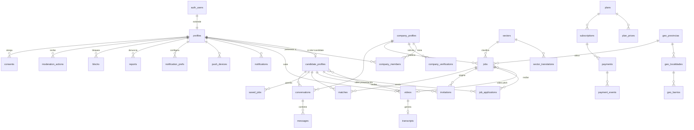

# TalentFlash Argentina — Modelo de Datos (PostgreSQL / Supabase)

**Última actualización:** 2026-09-02
**Estado:** propuesta inicial — pendiente de aprobación del fundador

> Fuente de verdad: el SPEC de producto (`SPEC_TALENTFLASH.md`); las referencias "SPEC §5" (ofertas) y "SPEC §8" (pagos) apuntan a ese documento. Documentos hermanos en `01_app/docs/` (SPEC §11): `PRODUCT.md`, `UX_FLOWS.md`, `ARCHITECTURE.md`, `PRIVACY.md`, `SECURITY.md`, `COST_DECISIONS.md`, `ROADMAP.md`.

---

## 1. Convenciones

- **PK:** `id uuid primary key default gen_random_uuid()` en todas las tablas, salvo `profiles` (comparte PK con `auth.users`) y catálogos geo (PK propia + código INDEC).
- **Timestamps:** `created_at timestamptz not null default now()` en todas; `updated_at timestamptz not null default now()` mantenido por trigger `set_updated_at()` en tablas mutables.
- **Soft delete:** columna `deleted_at timestamptz` en entidades de usuario/contenido (`profiles`, `candidate_profiles`, `company_profiles`, `videos`, `jobs`, `messages`). Las policies RLS filtran `deleted_at is null`. Tablas transaccionales (`payments`, `payment_events`, `reconcile_log`, `admin_audit_log`, `consents`, `ai_usage`) son **append-only**: sin update/delete (en `consents`, la revocación es una fila nueva con `granted = false`; ver §2.7).
- **Enums:** tipos PostgreSQL nativos (`create type ... as enum`). Cambios de enum = migración explícita.
- **Moneda:** `numeric(12,2)` + `currency_code char(3)` (ISO 4217). Nunca float.
- **Naming:** snake_case, singular para enums, plural para tablas. FKs `<entidad>_id`.
- **Esquemas:** entidades y RPC públicos en `public`; helpers RLS en `public` con `security definer`, `search_path` vacío y referencias calificadas; triggers internos en `private`; tests en `supabase/tests`.
- **Extensiones requeridas:** `pgcrypto` (gen_random_uuid), `pg_trgm` (búsqueda), `pg_cron` (retención/vencimientos).

### 1.1 Tipos enum

```sql
create type user_role as enum ('candidate','company','admin');
create type verification_status as enum ('pending','in_review','approved','rejected');
create type company_member_role as enum ('owner','admin','recruiter','viewer');
create type video_status as enum ('uploading','processing','ready','failed','expired','removed');
create type video_purpose as enum ('candidate_presentation','job_pitch','application_answer');
create type job_status as enum ('draft','active','paused','expired','closed');
create type work_mode as enum ('presencial','hibrido','remoto');
create type contract_type as enum ('relacion_dependencia','monotributo','plazo_fijo','temporal','pasantia','freelance');
create type jornada_type as enum ('full_time','part_time','por_turnos','fin_de_semana','por_horas');
create type experience_level as enum ('sin_experiencia','hasta_1_anio','1_a_3_anios','3_a_5_anios','mas_de_5_anios');
create type availability_type as enum ('inmediata','en_1_semana','en_2_semanas','en_1_mes','a_convenir');
create type salary_period as enum ('mensual','anual','por_hora');
create type application_status as enum ('submitted','viewed','shortlisted','interview','offer','rejected','withdrawn','hired');  -- canónica: UX_FLOWS.md §12 (ver equivalencias ES↔EN en §2.3)
create type invitation_status as enum ('sent','viewed','accepted','declined','expired');
create type match_source as enum ('ai','rule','manual');
create type conversation_origin as enum ('application','invitation');
create type notification_type as enum ('application_update','new_application','invitation','message','job_expiring','video_expiring','verification_update','payment','system');
create type push_platform as enum ('ios','android','web');
create type report_target as enum ('profile','company','job','video','message');
create type report_status as enum ('open','in_review','resolved','dismissed');
create type moderation_action_type as enum ('warning','content_removed','account_suspended','account_banned','account_reinstated');
create type consent_type as enum ('data_processing','video_profile_publication','ai_features','ai_training','age_declaration','terms_acceptance');  -- PRIVACY.md §4 + TyC (T-018); mapeo vigente en §2.7. 'terms_acceptance' agregado en 0020.
create type plan_audience as enum ('candidate','company');
create type billing_period as enum ('monthly','quarterly','yearly');
create type subscription_status as enum ('trialing','active','past_due','paused','canceled','expired');
create type payment_provider as enum ('mercado_pago');            -- extensible
create type payment_status as enum ('pending','in_process','approved','rejected','refunded','partially_refunded','charged_back','cancelled');
create type ai_feature as enum ('transcription','matching','job_description','moderation','profile_summary');
```

---

## 2. Tablas (SQL ilustrativo completo)

### 2.1 Identidad y perfiles

```sql
-- Extiende auth.users (Supabase). Fila creada por trigger on auth.users insert.
create table profiles (
  id            uuid primary key references auth.users(id) on delete cascade,
  role          user_role not null,
  email         text not null,                -- espejo de auth.users, para joins/admin
  full_name     text,
  avatar_url    text,
  phone         text,
  onboarding_completed boolean not null default false,
  suspended_until timestamptz,                -- seteado por moderación
  created_at    timestamptz not null default now(),
  updated_at    timestamptz not null default now(),
  deleted_at    timestamptz
);

create table candidate_profiles (
  id             uuid primary key default gen_random_uuid(),
  profile_id     uuid not null unique references profiles(id) on delete cascade,
  headline       text,                         -- "Vendedora con 3 años en retail"
  bio            text,
  birth_date     date,
  provincia_id   uuid references geo_provincias(id),
  localidad_id   uuid references geo_localidades(id),
  barrio_id      uuid references geo_barrios(id),
  work_mode_prefs work_mode[] not null default '{}',
  expected_salary_min numeric(12,2),
  expected_salary_max numeric(12,2),
  salary_currency char(3) not null default 'ARS',
  availability   availability_type,
  experience     experience_level,
  skills         text[] not null default '{}',
  languages      text[] not null default '{}',
  education      jsonb not null default '[]',  -- [{nivel, institucion, titulo, desde, hasta}]
  work_history   jsonb not null default '[]',  -- [{empresa, puesto, desde, hasta, descripcion}]
  weekly_availability jsonb not null default '[]', -- (0023) franjas [{day,start,end}]: day lun..dom
                                               -- (mismo formato que jobs.schedule_days), horas 'HH:MM';
                                               -- end < start = el turno cruza la medianoche
  cv_url         text,                         -- storage path (opcional, el video es lo central)
  video_id       uuid references videos(id),   -- video de presentación publicado
  sector_id      uuid references sectors(id),  -- sector de interés (T-016, 0020): UNO por candidato,
                                               -- igual que jobs.sector_id; multi-sector = migración futura
  is_published   boolean not null default false, -- DERIVADA server-side (0022): onboarding completo + datos
                                               -- mínimos + correo confirmado + consentimiento B vigente.
                                               -- El cliente no puede escribirla (trigger); la recalculan
                                               -- los triggers de consents/candidate_profiles/profiles.
  published_at   timestamptz,
  created_at     timestamptz not null default now(),
  updated_at     timestamptz not null default now(),
  deleted_at     timestamptz,
  constraint salary_range check (expected_salary_max is null or expected_salary_min is null
                                 or expected_salary_max >= expected_salary_min)
);

create table company_profiles (
  id             uuid primary key default gen_random_uuid(),
  name           text not null,                -- nombre de fantasía
  legal_name     text,                         -- razón social
  cuit           text not null unique
                 check (cuit ~ '^[0-9]{2}-?[0-9]{8}-?[0-9]$'),
  verification_status verification_status not null default 'pending',
  industry       text,                         -- legacy texto libre; la fuente pasa a ser sector_id (0020)
  sector_id      uuid references sectors(id),  -- rubro normalizado (T-017, 0020)
  size_range     text,                         -- '1-10','11-50','51-200','201-500','501+' (valida la RPC)
  description    text,
  logo_url       text,
  website        text,
  provincia_id   uuid references geo_provincias(id),
  localidad_id   uuid references geo_localidades(id),
  created_by     uuid not null references profiles(id),
  created_at     timestamptz not null default now(),
  updated_at     timestamptz not null default now(),
  deleted_at     timestamptz
);

create table company_members (
  id           uuid primary key default gen_random_uuid(),
  company_id   uuid not null references company_profiles(id) on delete cascade,
  profile_id   uuid not null references profiles(id) on delete cascade,
  member_role  company_member_role not null default 'recruiter',
  position_title text,                         -- cargo del solicitante (T-017, 0020)
  relationship text,                           -- relación con la empresa: 'owner'|'partner'|'manager'|'hr'|'other' (valida la RPC)
  invited_by   uuid references profiles(id),
  created_at   timestamptz not null default now(),
  unique (company_id, profile_id)
);

create table company_verifications (
  id             uuid primary key default gen_random_uuid(),
  company_id     uuid not null references company_profiles(id) on delete cascade,
  status         verification_status not null default 'pending',
  cuit_submitted text not null,
  documents      jsonb not null default '[]',  -- paths en bucket privado (constancia AFIP, etc.)
  submitted_by   uuid not null references profiles(id),
  reviewed_by    uuid references profiles(id), -- admin
  reviewed_at    timestamptz,
  rejection_reason text,
  created_at     timestamptz not null default now(),
  updated_at     timestamptz not null default now()
);
```

El trigger de alta acepta desde `raw_user_meta_data.role` únicamente
`candidate` o `company` (cualquier otro valor se degrada a `candidate`) y copia
el resultado a `raw_app_meta_data.role`, que es el claim confiable. Un cliente
nunca puede darse `admin`: ese rol se provisiona solo desde un contexto con
`service_role` y queda protegido por trigger ante `UPDATE` autenticados.

`profiles.onboarding_completed` es columna protegida desde 0022: solo la
marcan las RPC de finalización (`complete_candidate_onboarding`,
`complete_company_onboarding`), que validan datos mínimos, mayoría de edad y
consentimientos obligatorios vigentes y fallan cerradas. Un `UPDATE` directo
del cliente recibe 42501.

**Validación de contenido del perfil (0023, T-021).** El trigger
`validate_candidate_content` (SECURITY DEFINER, aplica en TODOS los contextos
— cliente, RPC y seed) valida: `headline` ≤120 y `bio` ≤2000; `skills` ≤20
ítems de ≤40 caracteres, sin vacíos ni duplicados case-insensitive;
`languages` ≤10×30; `work_history` ≤20 objetos `{empresa, puesto, desde,
hasta, descripcion}` con fechas `'YYYY-MM'` entre 1950-01 y el mes actual,
`desde ≤ hasta`, `hasta = null` = actualidad y claves extra rechazadas;
`education` ≤10 objetos `{nivel ∈ primario|secundario|terciario|universitario|
posgrado|curso, institucion, titulo?, desde?, hasta?}`; `weekly_availability`
≤21 franjas y ≤3 por día sin solapamientos sobre la línea de tiempo circular
de la semana (un turno vie 22–02 choca con sab 01–03; dom 23–01 choca con
lun); salario 0..999.999.999 con `salary_currency = 'ARS'`. Errores `TFDAT`.
Además, `protect_candidate_profile_update` exige que `video_id` solo pueda
vincular un video PROPIO con `purpose = 'candidate_presentation'` (o null), y
`protect_profile_update` suma `avatar_url` a las columnas protegidas de
`profiles`: solo la escribe la Edge Function `avatar` (0024).

> **Decisión de roles vigente:** rol único en `profiles.role`; no existe tabla
> `user_roles`. Un eventual modelo multi-rol requiere una decisión y migración
> dedicadas que actualicen `is_admin()` y todas las policies afectadas.

### 2.2 Video y transcripciones

```sql
create table videos (
  id             uuid primary key default gen_random_uuid(),
  owner_profile_id uuid not null references profiles(id) on delete cascade,
  purpose        video_purpose not null,
  status         video_status not null default 'uploading',
  provider       text not null default 'cloudflare_stream',
  stream_uid     text unique,                  -- UID en Cloudflare Stream
  duration_seconds integer check (duration_seconds between 1 and 120),
  thumbnail_url  text,
  playback_url   text,                         -- HLS
  size_bytes     bigint,
  expires_at     timestamptz,                  -- vencimiento: 30/60/90 días a elección del usuario, default 60
                                               -- (aprobado el 12-08-2026 por el fundador; PRIVACY §6, SPEC §9)
  error_reason   text,
  created_at     timestamptz not null default now(),
  updated_at     timestamptz not null default now(),
  deleted_at     timestamptz
);

create table transcripts (
  id            uuid primary key default gen_random_uuid(),
  video_id      uuid not null unique references videos(id) on delete cascade,
  language      char(2) not null default 'es',
  full_text     text not null,
  segments      jsonb not null default '[]',   -- [{start,end,text}]
  model         text not null,                 -- ej. whisper-large-v3
  status        text not null default 'ready',
  created_at    timestamptz not null default now()
);
```

### 2.3 Ofertas, postulaciones y matching

Todos los campos obligatorios del SPEC §5 son `not null` (el estado `draft` es la única excepción funcional: la API valida completitud recién al publicar; ver `ARCHITECTURE.md`).

**Máquina de estados de postulación — canónica: `UX_FLOWS.md` §12** (incluye *oferta* y *retirada*). El enum se persiste en inglés; la UI muestra es-AR. `PRODUCT.md` §6.6 y `ROADMAP.md` T-040 deben corregirse para usar esta misma tabla de equivalencias:

| UX_FLOWS §12 (ES) | enum `application_status` (EN) |
|---|---|
| enviada | `submitted` |
| vista | `viewed` |
| preseleccionada | `shortlisted` |
| entrevista | `interview` |
| oferta | `offer` |
| rechazada / descartada | `rejected` |
| retirada | `withdrawn` |
| contratada | `hired` |

**Estado "vista" — aprobado el 12-08-2026 por el fundador.** `viewed` se registra únicamente cuando un recruiter abre el **detalle** de la postulación (evento de apertura → `job_applications.viewed_at`). **Prohibido** registrar o inferir atención, interés, emoción o calidad de la visualización (tiempo de reproducción, re-visitas, scroll, heatmaps, etc.): el único dato admitido es el evento de apertura.

**Estados visibles para el candidato — aprobado el 12-08-2026 por el fundador.** La tabla anterior nombra los estados internos en ES para la UI de la empresa (UX_FLOWS §12); el candidato, en cambio, ve exactamente **seis** estados. Mapeo contra el enum interno `application_status`:

| Estado visible para el candidato | enum interno `application_status` |
|---|---|
| enviada | `submitted` |
| vista | `viewed`, `shortlisted` (la preselección es interna: al candidato se le muestra "vista" para no exponer señales de interés) |
| entrevista propuesta | `interview` |
| aceptada | `offer`, `hired` |
| rechazada | `rejected` |
| cerrada | `withdrawn`; también toda postulación cuya búsqueda pasó a `closed`/`expired` sin resolución |

```sql
create table jobs (
  id               uuid primary key default gen_random_uuid(),
  company_id       uuid not null references company_profiles(id) on delete cascade,
  created_by       uuid not null references profiles(id),
  title            text not null,
  description      text not null,
  sector_id        uuid references sectors(id),   -- rubro (catálogo localizable, §2.9 y ARCHITECTURE.md §8)
  -- §5: rango salarial obligatorio
  salary_min       numeric(12,2) not null check (salary_min >= 0),
  salary_max       numeric(12,2) not null,
  salary_currency  char(3) not null default 'ARS',
  salary_period    salary_period not null default 'mensual',
  -- §5: modalidad contractual (relación de dependencia / monotributo / etc.)
  contract_type    contract_type not null,
  -- §5: jornada + días y horarios
  jornada          jornada_type not null,
  schedule_days    text[] not null,               -- ['lun','mar','mie','jue','vie']
  schedule_detail  text not null,                 -- "9 a 18 hs, viernes hasta 15"
  -- §5: presencial / híbrido / remoto + geo
  work_mode        work_mode not null,
  provincia_id     uuid not null references geo_provincias(id),
  localidad_id     uuid not null references geo_localidades(id),
  barrio_id        uuid references geo_barrios(id), -- obligatorio solo en CABA/GBA (valida API)
  -- §5: experiencia, disponibilidad, beneficios, vencimiento
  experience       experience_level not null,
  availability     availability_type not null,
  benefits         text[] not null default '{}',
  expires_at       timestamptz not null,
  vacancies        integer not null default 1 check (vacancies > 0),
  video_id         uuid references videos(id),    -- pitch en video de la búsqueda
  status           job_status not null default 'draft',
  published_at     timestamptz,
  closed_at        timestamptz,
  created_at       timestamptz not null default now(),
  updated_at       timestamptz not null default now(),
  deleted_at       timestamptz,
  constraint salary_range check (salary_max >= salary_min)
);

create table job_applications (
  id                   uuid primary key default gen_random_uuid(),
  job_id               uuid not null references jobs(id) on delete cascade,
  candidate_profile_id uuid not null references candidate_profiles(id) on delete cascade,
  status               application_status not null default 'submitted',
  cover_note           text,
  video_id             uuid references videos(id),  -- video-respuesta opcional
  viewed_at            timestamptz,                 -- evento de apertura del DETALLE por un recruiter (estado "vista"; ver nota arriba)
  status_history       jsonb not null default '[]', -- [{status, at, by}]
  created_at           timestamptz not null default now(),
  updated_at           timestamptz not null default now(),
  unique (job_id, candidate_profile_id)
);

create table invitations (
  id                   uuid primary key default gen_random_uuid(),
  job_id               uuid not null references jobs(id) on delete cascade,
  company_id           uuid not null references company_profiles(id) on delete cascade,
  candidate_profile_id uuid not null references candidate_profiles(id) on delete cascade,
  sent_by              uuid not null references profiles(id),
  status               invitation_status not null default 'sent',
  message              text,
  expires_at           timestamptz,
  created_at           timestamptz not null default now(),
  updated_at           timestamptz not null default now(),
  unique (job_id, candidate_profile_id)
);

create table matches (
  id                   uuid primary key default gen_random_uuid(),
  job_id               uuid not null references jobs(id) on delete cascade,
  candidate_profile_id uuid not null references candidate_profiles(id) on delete cascade,
  score                numeric(5,4) not null check (score between 0 and 1),
  source               match_source not null default 'ai',
  features             jsonb not null default '{}', -- explicabilidad del score
  created_at           timestamptz not null default now(),
  unique (job_id, candidate_profile_id)
);

create table saved_jobs (
  candidate_profile_id uuid not null references candidate_profiles(id) on delete cascade,
  job_id               uuid not null references jobs(id) on delete cascade,
  created_at           timestamptz not null default now(),
  primary key (candidate_profile_id, job_id)
);
```

### 2.4 Mensajería

```sql
create table conversations (
  id                   uuid primary key default gen_random_uuid(),
  company_id           uuid not null references company_profiles(id) on delete cascade,
  candidate_profile_id uuid not null references candidate_profiles(id) on delete cascade,
  job_id               uuid references jobs(id) on delete set null,
  origin               conversation_origin not null,  -- chat solo post-postulación o post-invitación aceptada
  last_message_at      timestamptz,
  created_at           timestamptz not null default now(),
  unique (company_id, candidate_profile_id, job_id)
);

create table messages (
  id               uuid primary key default gen_random_uuid(),
  conversation_id  uuid not null references conversations(id) on delete cascade,
  sender_profile_id uuid not null references profiles(id),
  body             text not null check (length(body) <= 4000),
  attachments      jsonb not null default '[]',
  read_at          timestamptz,
  created_at       timestamptz not null default now(),
  deleted_at       timestamptz          -- "eliminar para todos" = soft delete, cuerpo se anonimiza
);
```

### 2.5 Notificaciones

```sql
create table notifications (
  id          uuid primary key default gen_random_uuid(),
  profile_id  uuid not null references profiles(id) on delete cascade,
  type        notification_type not null,
  title       text not null,
  body        text,
  data        jsonb not null default '{}',   -- deep link payload
  read_at     timestamptz,
  created_at  timestamptz not null default now()
);

create table push_devices (
  id           uuid primary key default gen_random_uuid(),
  profile_id   uuid not null references profiles(id) on delete cascade,
  platform     push_platform not null,
  token        text not null unique,
  last_seen_at timestamptz not null default now(),
  created_at   timestamptz not null default now()
);

-- Preferencias por categoría (UX_FLOWS.md §14, ROADMAP.md T-019).
-- OPT-IN EXPLÍCITO (corregido en 0020): sin fila —o al crearla sin decidir—
-- push y correo quedan APAGADOS; solo lo in-app operativo está activo. El
-- despacho (T-064) lee estas filas tal cual, sin reinterpretar; para una
-- categoría sin fila aplica exactamente estos defaults. Los avisos de cuenta
-- y seguridad ('system') no admiten in_app_enabled/email_enabled en false
-- para clientes (trigger de 0021); su push sí es decisión del usuario.
create table notification_prefs (
  id             uuid primary key default gen_random_uuid(),
  profile_id     uuid not null references profiles(id) on delete cascade,
  category       notification_type not null,
  push_enabled   boolean not null default false,
  email_enabled  boolean not null default false,
  in_app_enabled boolean not null default true,
  created_at     timestamptz not null default now(),
  updated_at     timestamptz not null default now(),
  unique (profile_id, category)
);
```

### 2.6 Confianza y moderación

```sql
create table reports (
  id                  uuid primary key default gen_random_uuid(),
  reporter_profile_id uuid not null references profiles(id) on delete cascade,
  target_type         report_target not null,
  target_id           uuid not null,             -- FK lógica, validada en API
  reason              text not null,             -- catálogo cerrado en app
  details             text,
  status              report_status not null default 'open',
  resolved_by         uuid references profiles(id),
  resolved_at         timestamptz,
  created_at          timestamptz not null default now()
);

create table blocks (
  id                  uuid primary key default gen_random_uuid(),
  blocker_profile_id  uuid not null references profiles(id) on delete cascade,
  blocked_profile_id  uuid not null references profiles(id) on delete cascade,
  created_at          timestamptz not null default now(),
  unique (blocker_profile_id, blocked_profile_id),
  check (blocker_profile_id <> blocked_profile_id)
);

create table moderation_actions (
  id                uuid primary key default gen_random_uuid(),
  actor_profile_id  uuid not null references profiles(id),    -- admin
  target_profile_id uuid references profiles(id),
  target_company_id uuid references company_profiles(id),
  report_id         uuid references reports(id),
  action            moderation_action_type not null,
  reason            text not null,
  expires_at        timestamptz,                 -- suspensiones temporales
  created_at        timestamptz not null default now(),
  check (target_profile_id is not null or target_company_id is not null)
);

create table admin_audit_log (
  id           uuid primary key default gen_random_uuid(),
  admin_id     uuid not null references profiles(id),
  action       text not null,                    -- 'company.verify','user.ban',...
  entity_type  text not null,
  entity_id    uuid,
  before       jsonb,
  after        jsonb,
  ip           inet,
  created_at   timestamptz not null default now()
);  -- append-only: sin UPDATE/DELETE (revocados por GRANT y sin policy)
```

### 2.7 Consentimientos

Mapeo vigente con `UX_FLOWS.md` §2.3 (esta versión CORRIGE la de antes de
Bloque C, que etiquetaba los toggles distinto e incluía `ai_training` como
toggle C — esa era la inconsistencia documental entre ROADMAP/UX_FLOWS/PRIVACY
y este enum):

- **Obligatorios:** `terms_acceptance` (TyC — aceptación contractual, exigida por T-018; no es un consentimiento de datos de la Ley 25.326 pero comparte el mismo ledger auditable), `data_processing` (A) y `age_declaration` (A′ — SPEC §9).
- **Toggles opcionales de UX_FLOWS §2.3:** B = `video_profile_publication`, C = `ai_features`.
- **`ai_training` NO se solicita en el MVP** (SPEC §6): el valor existe en el enum pero no tiene fila en `consent_versions`, y sin versión vigente la base rechaza cualquier otorgamiento desde el cliente. Habilitarlo requiere migración y decisión explícitas.

**Append-only real:** cada evento (otorgar **o** revocar) es una fila nueva; el estado vigente es la última fila por `(profile_id, consent_type)` **ordenada por `seq`** (agregada en 0020: `created_at` puede empatar dentro de una transacción). Nunca UPDATE ni DELETE (evidencia legal, Ley 25.326). Reglas del trigger `guard_consent_write` (0021), solo para escrituras de clientes: otorgar exige la versión VIGENTE del texto; revocar admite la vigente o la aceptada; repetir exactamente el último comando no inserta fila (sin duplicados).

```sql
create table consents (
  id           uuid primary key default gen_random_uuid(),
  profile_id   uuid not null references profiles(id) on delete cascade,
  consent_type consent_type not null,
  granted      boolean not null,                 -- true = otorga; false = revoca
  version      text not null,                    -- versión del documento, ej. '2026-08-31'
  ip           inet,
  user_agent   text,                             -- canal ('app_web', 'app_android', …)
  seq          bigint generated always as identity,  -- orden total del ledger (0020)
  created_at   timestamptz not null default now()
);

-- T-020: documentos legales versionados; el texto vive acá para que la UI y
-- la versión registrada en consents no puedan divergir. Lectura pública
-- (también anon); escritura solo por migración/service role.
create table legal_documents (
  id           uuid primary key default gen_random_uuid(),
  slug         text not null,                  -- 'terminos' | 'privacidad'
  version      text not null,
  title        text not null,
  body         text not null,
  locale       text not null default 'es-AR',
  published_at timestamptz not null default now(),
  created_at   timestamptz not null default now(),
  unique (slug, version)
);

-- T-018: versión vigente por consentimiento — ÚNICA fuente de verdad para la
-- UI, las RPC y los tests. Subir una versión obligatoria fuerza el
-- reconsentimiento (guard 6); subir la de video despublica los perfiles hasta
-- re-aceptar (trigger de 0022, fail-closed).
create table consent_versions (
  consent_type  consent_type primary key,
  version       text not null,
  document_slug text not null,
  is_mandatory  boolean not null default false,
  updated_at    timestamptz not null default now(),
  foreign key (document_slug, version) references legal_documents (slug, version)
);
```

### 2.8 Monetización (ver SPEC §8 y `ARCHITECTURE.md` §7)

```sql
create table plans (
  id         uuid primary key default gen_random_uuid(),
  code       text not null unique,              -- 'candidate_free','company_starter','company_pro'
  audience   plan_audience not null,
  name       text not null,
  features   jsonb not null default '{}',
  limits     jsonb not null default '{}',       -- {active_jobs: 3, invitations_month: 50,...} (valores: propuesta a validar)
  is_active  boolean not null default true,
  created_at timestamptz not null default now(),
  updated_at timestamptz not null default now()
);

create table plan_prices (
  id            uuid primary key default gen_random_uuid(),
  plan_id       uuid not null references plans(id) on delete cascade,
  amount        numeric(12,2) not null check (amount >= 0),  -- montos: propuesta a validar, se cargan por seed/admin
  currency_code char(3) not null default 'ARS',
  country_code  char(2) not null default 'AR',
  billing_period billing_period not null default 'monthly',
  valid_from    timestamptz not null default now(),          -- vigencia
  valid_to      timestamptz,                                 -- null = vigente
  provider_price_id text,                                    -- id del plan en Mercado Pago
  created_at    timestamptz not null default now(),
  unique (plan_id, currency_code, country_code, billing_period, valid_from)
);

create table subscriptions (
  id            uuid primary key default gen_random_uuid(),
  profile_id    uuid references profiles(id) on delete cascade,      -- suscriptor candidato
  company_id    uuid references company_profiles(id) on delete cascade, -- o empresa
  plan_id       uuid not null references plans(id),
  plan_price_id uuid not null references plan_prices(id),
  status        subscription_status not null default 'trialing',
  provider      payment_provider not null default 'mercado_pago',
  provider_subscription_id text unique,          -- preapproval_id MP
  current_period_start timestamptz not null,
  current_period_end   timestamptz not null,
  cancel_at_period_end boolean not null default false,
  trial_end     timestamptz,
  canceled_at   timestamptz,
  created_at    timestamptz not null default now(),
  updated_at    timestamptz not null default now(),
  check (num_nonnulls(profile_id, company_id) = 1)   -- exactamente un titular
);

-- Cubre 1:1 los campos mínimos de SPEC §8 (validación hecha; ver mapeo debajo).
create table payments (
  id                  uuid primary key default gen_random_uuid(),
  subscription_id     uuid references subscriptions(id) on delete set null,
  payer_profile_id    uuid not null references profiles(id),
  company_id          uuid references company_profiles(id),
  provider            payment_provider not null default 'mercado_pago',
  provider_customer_id text,                     -- §8: id del pagador en el proveedor (payer.id de MP)
  provider_payment_id text not null,             -- §8: payment.id de MP
  status              payment_status not null default 'pending',
  status_detail       text,                      -- status_detail crudo de MP
  amount              numeric(12,2) not null,    -- §8: monto cobrado
  gross_amount        numeric(12,2),             -- §8: bruto antes de fees/impuestos (transaction_amount de MP)
  currency_code       char(3) not null default 'ARS',
  country_code        char(2) not null default 'AR',
  description         text,
  payment_method      text,                      -- 'credit_card','account_money',...
  installments        integer,
  provider_fee        numeric(12,2),             -- §8: comisión del proveedor (fee_details de MP)
  estimated_taxes     numeric(12,2),             -- §8: impuestos estimados (taxes de MP)
  net_amount          numeric(12,2),             -- §8: neto acreditado
  billing_period_start timestamptz,              -- §8: inicio del período facturado
  billing_period_end   timestamptz,              -- §8: fin del período facturado
  external_reference  text,                      -- nuestro id de correlación
  paid_at             timestamptz,
  refunded_at         timestamptz,
  refund_amount       numeric(12,2),
  failure_code        text,
  failure_reason      text,
  raw                 jsonb not null default '{}',
  created_at          timestamptz not null default now(),
  updated_at          timestamptz not null default now(),
  unique (provider, provider_payment_id)
);

-- Idempotencia de webhooks: cada evento del proveedor se registra una sola vez.
create table payment_events (
  id                 uuid primary key default gen_random_uuid(),
  provider           payment_provider not null default 'mercado_pago',
  provider_event_id  text not null,
  event_type         text not null,              -- 'payment.updated','subscription_preapproval',...
  payment_id         uuid references payments(id),
  payload            jsonb not null,
  processed_at       timestamptz,                -- null = pendiente/reintento
  error              text,
  received_at        timestamptz not null default now(),
  unique (provider, provider_event_id)           -- clave de idempotencia
);

-- Reconciliación periódica contra la API del proveedor (SPEC §8, ARCHITECTURE.md §7.3).
-- Append-only; escribe solo el service role desde el job programado.
create table reconcile_log (
  id               uuid primary key default gen_random_uuid(),
  provider         payment_provider not null default 'mercado_pago',
  period_start     timestamptz not null,
  period_end       timestamptz not null,
  payments_checked integer not null default 0,
  discrepancies    integer not null default 0,
  details          jsonb not null default '[]',  -- [{payment_id, campo, valor_local, valor_proveedor}]
  status           text not null default 'running',  -- 'running','ok','discrepancies','error'
  run_started_at   timestamptz not null default now(),
  run_finished_at  timestamptz
);
```

**Mapeo 1:1 contra SPEC §8:** `amount`, `currency_code`, `country_code`, `provider`, `provider_customer_id`, `provider_payment_id`, `gross_amount`, `provider_fee`, `estimated_taxes`, `net_amount`, `status`, `paid_at`, `billing_period_start` y `billing_period_end` existen en `payments` con el mismo nombre que en el SPEC. `provider_subscription_id` se persiste en `subscriptions.provider_subscription_id` y se alcanza vía `payments.subscription_id`. Los nombres anteriores `fee_amount`/`tax_amount` fueron **renombrados** a `provider_fee`/`estimated_taxes` para coincidir con el SPEC (en la API de MP corresponden a `fee_details` y `taxes`).

### 2.9 IA y catálogos (sectores, geo)

```sql
create table ai_usage (
  id            uuid primary key default gen_random_uuid(),
  profile_id    uuid references profiles(id) on delete set null,
  feature       ai_feature not null,
  model         text not null,
  input_tokens  integer not null default 0,
  output_tokens integer not null default 0,
  cost_usd      numeric(10,6) not null default 0,  -- calculado con ai_pricing vigente al momento del uso
  entity_type   text,                            -- 'video','job','candidate_profile'
  entity_id     uuid,
  created_at    timestamptz not null default now()
);

-- Precios de modelos de IA (ARCHITECTURE.md §5.4): nunca hardcodeados en Edge Functions.
-- Vigencia por rango; seed según SPEC §4: claude-fable-5 $10/$50, claude-sonnet-5 $3/$15,
-- claude-haiku-4-5 $1/$5 por MTok; Batch −50%; lecturas de caché ~0,1×.
create table ai_pricing (
  id                    uuid primary key default gen_random_uuid(),
  model                 text not null,           -- 'claude-fable-5','claude-sonnet-5','claude-haiku-4-5'
  input_usd_per_mtok    numeric(10,4) not null,
  output_usd_per_mtok   numeric(10,4) not null,
  batch_discount        numeric(4,3) not null default 0.500,   -- Batch API −50%
  cache_read_multiplier numeric(5,4) not null default 0.1000,  -- prompt caching ~0,1×
  valid_from            timestamptz not null default now(),
  valid_to              timestamptz,             -- null = vigente
  created_at            timestamptz not null default now(),
  unique (model, valid_from)
);

-- Catálogo de sectores localizable (ARCHITECTURE.md §8). Seed inicial: gastronomía y
-- hotelería; luego comercio, ventas, logística, depósitos (SPEC §2). Traducciones por
-- locale para la expansión es-UY/es-CL/es-CO/es-PE/pt-BR.
create table sectors (
  id         uuid primary key default gen_random_uuid(),
  code       text not null unique,               -- 'gastronomia_hoteleria','comercio',...
  sort_order integer not null default 0,
  is_active  boolean not null default true,
  created_at timestamptz not null default now()
);

create table sector_translations (
  sector_id  uuid not null references sectors(id) on delete cascade,
  locale     text not null,                      -- 'es-AR','pt-BR',...
  name       text not null,
  primary key (sector_id, locale)
);

-- Catálogo seed desde INDEC/Georef AR (solo lectura para la app).
create table geo_provincias (
  id         uuid primary key default gen_random_uuid(),
  indec_code text not null unique,               -- '02' CABA, '06' Buenos Aires...
  name       text not null
);

create table geo_localidades (
  id           uuid primary key default gen_random_uuid(),
  provincia_id uuid not null references geo_provincias(id),
  indec_code   text unique,
  name         text not null
);

create table geo_barrios (
  id           uuid primary key default gen_random_uuid(),
  localidad_id uuid not null references geo_localidades(id),
  name         text not null,
  unique (localidad_id, name)
);
```

---

## 3. Relaciones (diagrama)



Reglas de borrado en cascada: borrar `auth.users` → cascada a `profiles` → cascada a todo lo del usuario (el flujo real es soft delete + purga diferida, §7 de este doc). `payments` nunca cascadea: `subscription_id` es `on delete set null` para preservar el registro contable. Tablas operativas sin FK (fuera del diagrama): `reconcile_log`, `ai_pricing`.

---

## 4. Índices

```sql
-- FKs consultadas (Postgres no indexa FKs automáticamente)
create index idx_candidate_profiles_profile on candidate_profiles(profile_id);
create index idx_company_members_company on company_members(company_id);
create index idx_company_members_profile on company_members(profile_id);
create index idx_jobs_company on jobs(company_id);
create index idx_applications_job on job_applications(job_id);
create index idx_applications_candidate on job_applications(candidate_profile_id);
create index idx_invitations_candidate on invitations(candidate_profile_id);
create index idx_matches_candidate on matches(candidate_profile_id);
create index idx_messages_conversation on messages(conversation_id, created_at desc);
create index idx_notifications_profile on notifications(profile_id, created_at desc)
  where read_at is null;                          -- badge de no leídas
create index idx_videos_owner on videos(owner_profile_id);
create index idx_payments_subscription on payments(subscription_id);
create index idx_payments_payer on payments(payer_profile_id, created_at desc);
create index idx_consents_latest on consents(profile_id, consent_type, created_at desc); -- estado vigente = última fila
create index idx_consents_latest_by_seq on consents(profile_id, consent_type, seq desc); -- 0020: orden determinista del ledger
create index idx_candidate_profiles_sector on candidate_profiles(sector_id);             -- 0020

-- Parciales por estado activo (feeds y búsqueda solo tocan lo vivo)
create index idx_jobs_active on jobs(published_at desc)
  where status = 'active' and deleted_at is null;
create index idx_jobs_active_geo on jobs(provincia_id, localidad_id)
  where status = 'active' and deleted_at is null;
create index idx_jobs_active_sector on jobs(sector_id)
  where status = 'active' and deleted_at is null;
create index idx_candidates_published on candidate_profiles(published_at desc)
  where is_published and deleted_at is null;
create index idx_subscriptions_active on subscriptions(profile_id, company_id)
  where status in ('trialing','active');
create index idx_videos_expiring on videos(expires_at)
  where status = 'ready';                          -- job de vencimiento (pg_cron)
create index idx_payment_events_pending on payment_events(received_at)
  where processed_at is null;                      -- cola de reintento de webhooks

-- Búsqueda de texto (pg_trgm, tolerante a tipeos)
create index idx_jobs_title_trgm on jobs using gin (title gin_trgm_ops);
create index idx_jobs_desc_trgm on jobs using gin (description gin_trgm_ops);
create index idx_candidates_headline_trgm on candidate_profiles using gin (headline gin_trgm_ops);
create index idx_candidates_skills on candidate_profiles using gin (skills);

-- Feeds por fecha
create index idx_jobs_created on jobs(created_at desc);
create index idx_conversations_last_msg on conversations(last_message_at desc nulls last);
```

---

## 5. RLS (Row Level Security)

`alter table <t> enable row level security;` en **todas** las tablas. El `service_role` de Supabase bypassa RLS (es el único camino de escritura para pagos, webhooks, matching y jobs programados; ver `ARCHITECTURE.md`). Sin policy explícita = sin acceso para `authenticated`/`anon`.

### 5.1 Funciones helper

```sql
create or replace function is_admin() returns boolean
language sql stable security definer set search_path = '' as $$
  select exists (select 1 from public.profiles
                 where id = auth.uid() and role = 'admin' and deleted_at is null);
$$;

create or replace function is_company_member(p_company_id uuid) returns boolean
language sql stable security definer set search_path = '' as $$
  select exists (select 1 from public.company_members
                 where company_id = p_company_id and profile_id = auth.uid());
$$;

create or replace function is_verified_company_member() returns boolean
language sql stable security definer set search_path = '' as $$
  select exists (select 1
                 from public.company_members cm
                 join public.company_profiles cp on cp.id = cm.company_id
                 where cm.profile_id = auth.uid()
                   and cp.verification_status = 'approved'
                   and cp.deleted_at is null);
$$;

create or replace function has_active_subscription(p_company_id uuid default null)
returns boolean
language sql stable security definer set search_path = '' as $$
  select exists (select 1 from public.subscriptions s
                 where s.status in ('trialing','active')
                   and s.current_period_end > now()
                   and ((p_company_id is not null and s.company_id = p_company_id)
                     or (p_company_id is null and s.profile_id = auth.uid())));
$$;
-- (0023 la endurece: con p_company_id ajeno — ni miembro ni admin — devuelve
-- false; el estado de suscripción de otra empresa no se filtra por RPC.)

-- Endurecida en 0023 (auditoría del Bloque D): PostgREST expone toda función
-- de `public` como RPC y las policies necesitan su EXECUTE, así que la
-- defensa vive adentro — el caller debe SER una de las dos partes; si no,
-- devuelve false (nadie sondea bloqueos entre terceros).
create or replace function are_blocked(p_a uuid, p_b uuid) returns boolean
language sql stable security definer set search_path = '' as $$
  select case
    when auth.uid() is null then false
    when p_a is distinct from auth.uid() and p_b is distinct from auth.uid()
      then false
    else exists (select 1 from public.blocks
                 where (blocker_profile_id = p_a and blocked_profile_id = p_b)
                    or (blocker_profile_id = p_b and blocked_profile_id = p_a))
  end;
$$;

create or replace function candidate_id() returns uuid
language sql stable security definer set search_path = '' as $$
  select id from public.candidate_profiles where profile_id = auth.uid();
$$;
```

### 5.2 Policies por tabla (SQL concreto)

```sql
-- PROFILES: cada uno lo suyo; admin todo.
create policy profiles_select_own on profiles for select
  using (id = auth.uid() or is_admin());
create policy profiles_update_own on profiles for update
  using (id = auth.uid() and deleted_at is null)
  with check (id = auth.uid() and deleted_at is null);
-- El trigger protect_profile_update bloquea role, email, suspended_until,
-- created_at y deleted_at para usuarios comunes.

-- CANDIDATE_PROFILES: dueño CRUD; admin todo. La policy
-- `cand_visible_to_verified_companies` (empresas verificadas leían la FILA
-- CRUDA de perfiles publicados) fue ELIMINADA en 0023 (auditoría de
-- privacidad, T-024): exponía birth_date, expectativa salarial, video_id y
-- cv_url. Las empresas acceden SOLO por la proyección con whitelist del RPC
-- `get_candidate_public_profile` (ver "Helpers y RPCs del Bloque D", abajo).
create policy cand_owner_all on candidate_profiles for all
  using (profile_id = auth.uid())
  with check (profile_id = auth.uid());
create policy cand_admin on candidate_profiles for all using (is_admin());

-- COMPANY_PROFILES: miembros gestionan; cualquiera autenticado ve empresas verificadas
-- (necesario para mostrar la empresa en una oferta).
create policy comp_member_select on company_profiles for select
  using (is_company_member(id) or (verification_status = 'approved' and deleted_at is null) or is_admin());
create policy comp_member_update on company_profiles for update
  using (exists (select 1 from company_members cm
                 where cm.company_id = company_profiles.id
                   and cm.profile_id = auth.uid()
                   and cm.member_role in ('owner','admin')));
-- No hay INSERT directo para authenticated. create_company_with_owner(...)
-- crea company_profiles + el primer company_members(owner) atómicamente.

-- COMPANY_MEMBERS: miembros ven su empresa; owner/admin gestionan.
create policy cm_select on company_members for select
  using (is_company_member(company_id) or is_admin());
create policy cm_manage on company_members for insert
  with check (exists (select 1 from company_members
                      where company_id = company_members.company_id
                        and profile_id = auth.uid() and member_role in ('owner','admin')));
create policy cm_delete on company_members for delete
  using (exists (select 1 from company_members me
                 where me.company_id = company_members.company_id
                   and me.profile_id = auth.uid() and me.member_role in ('owner','admin')));

-- COMPANY_VERIFICATIONS: la empresa crea y consulta; solo admin resuelve.
create policy cv_company_insert on company_verifications for insert
  with check (is_company_member(company_id) and submitted_by = auth.uid());
create policy cv_company_select on company_verifications for select
  using (is_company_member(company_id) or is_admin());
create policy cv_admin_update on company_verifications for update
  using (is_admin());

-- VIDEOS: dueño CRUD; empresa ve el video solo por postulación a SU oferta.
-- videos_company_select fue RE-CREADA en 0023 SIN su rama 1 (videos de
-- candidatos publicados): esa rama entregaba la fila completa — con
-- owner_profile_id, el id de auth del candidato — y permitía enumerar
-- candidatos publicados por REST. La reproducción para empresas llega con el
-- Bloque K (URLs firmadas, T-054); hoy la empresa solo conoce el booleano
-- presentation_available de la proyección de T-024.
create policy videos_owner_all on videos for all
  using (owner_profile_id = auth.uid())
  with check (owner_profile_id = auth.uid());
create policy videos_company_select on videos for select
  using (
    deleted_at is null and status = 'ready' and (
      exists (select 1 from job_applications a
              join jobs j on j.id = a.job_id
              where a.video_id = videos.id and is_company_member(j.company_id))
      or exists (select 1 from jobs j            -- video pitch de la propia oferta, visible a todos
                 where j.video_id = videos.id and j.status = 'active')
    )
  );
create policy videos_admin on videos for all using (is_admin());

-- TRANSCRIPTS: hereda la visibilidad del video.
create policy tr_select on transcripts for select
  using (exists (select 1 from videos v where v.id = transcripts.video_id)); -- RLS de videos ya filtró
  -- Nota: la subconsulta corre bajo las policies de videos ⇒ visible solo si el video es visible.

-- JOBS: ofertas activas visibles para cualquier autenticado; la empresa gestiona las suyas.
create policy jobs_public_select on jobs for select
  using ((status = 'active' and deleted_at is null) or is_company_member(company_id) or is_admin());
create policy jobs_company_write on jobs for insert
  with check (is_company_member(company_id));
create policy jobs_company_update on jobs for update
  using (is_company_member(company_id));

-- JOB_APPLICATIONS: candidato crea/ve/retira lo suyo; la empresa ve/gestiona postulaciones a SUS ofertas.
create policy app_candidate_insert on job_applications for insert
  with check (candidate_profile_id = candidate_id()
              and exists (select 1 from jobs j where j.id = job_id
                          and j.status = 'active' and j.deleted_at is null));
create policy app_candidate_select on job_applications for select
  using (candidate_profile_id = candidate_id());
create policy app_candidate_withdraw on job_applications for update
  using (candidate_profile_id = candidate_id())
  with check (status = 'withdrawn');
create policy app_company_select on job_applications for select
  using (exists (select 1 from jobs j where j.id = job_id and is_company_member(j.company_id)));
create policy app_company_update on job_applications for update
  using (exists (select 1 from jobs j where j.id = job_id and is_company_member(j.company_id)));
create policy app_admin on job_applications for all using (is_admin());

-- INVITATIONS: empresa emite y ve; candidato ve y responde las suyas.
create policy inv_company_insert on invitations for insert
  with check (is_company_member(company_id) and sent_by = auth.uid());
create policy inv_company_select on invitations for select
  using (is_company_member(company_id));
create policy inv_candidate_select on invitations for select
  using (candidate_profile_id = candidate_id());
create policy inv_candidate_respond on invitations for update
  using (candidate_profile_id = candidate_id())
  with check (status in ('viewed','accepted','declined'));

-- MATCHES: lectura por las dos partes; escritura solo service role (sin policy de insert/update).
create policy match_candidate_select on matches for select
  using (candidate_profile_id = candidate_id());
create policy match_company_select on matches for select
  using (exists (select 1 from jobs j where j.id = job_id and is_company_member(j.company_id)));

-- CONVERSATIONS y MESSAGES: solo participantes; blocks cortan visibilidad y escritura.
-- Re-creada en 0023 (auditoría): la subconsulta original sobre
-- candidate_profiles corría bajo el RLS del caller y, sin la policy de
-- lectura empresarial, daba NULL — el corte por bloqueo quedaba muerto para
-- la empresa. El lookup pasa al helper DEFINER blocked_with_candidate, que
-- devuelve solo un booleano.
create policy conv_participants_select on conversations for select
  using (
    (candidate_profile_id = candidate_id() or is_company_member(company_id))
    and not blocked_with_candidate(candidate_profile_id)
  );
create policy msg_participants_select on messages for select
  using (deleted_at is null
         and exists (select 1 from conversations c where c.id = conversation_id)); -- RLS de conversations filtra
create policy msg_participants_insert on messages for insert
  with check (
    sender_profile_id = auth.uid()
    and exists (select 1 from conversations c where c.id = conversation_id)        -- soy participante no bloqueado
  );
create policy msg_mark_read on messages for update
  using (exists (select 1 from conversations c where c.id = conversation_id))
  with check (sender_profile_id <> auth.uid());   -- solo marcar leído lo ajeno

-- SAVED_JOBS: solo el candidato.
create policy saved_own on saved_jobs for all
  using (candidate_profile_id = candidate_id())
  with check (candidate_profile_id = candidate_id());

-- NOTIFICATIONS: dueño lee y marca leído; inserta el backend (service role).
create policy notif_owner_select on notifications for select using (profile_id = auth.uid());
create policy notif_owner_read on notifications for update
  using (profile_id = auth.uid()) with check (profile_id = auth.uid());

-- PUSH_DEVICES: solo el dueño.
create policy push_own on push_devices for all
  using (profile_id = auth.uid()) with check (profile_id = auth.uid());

-- NOTIFICATION_PREFS: solo el dueño gestiona sus preferencias.
create policy nprefs_own on notification_prefs for all
  using (profile_id = auth.uid()) with check (profile_id = auth.uid());

-- REPORTS: denunciante crea y ve lo suyo; admin gestiona.
create policy rep_insert on reports for insert with check (reporter_profile_id = auth.uid());
create policy rep_select_own on reports for select
  using (reporter_profile_id = auth.uid() or is_admin());
create policy rep_admin_update on reports for update using (is_admin());

-- BLOCKS: el que bloquea gestiona sus bloqueos.
create policy blocks_own on blocks for all
  using (blocker_profile_id = auth.uid()) with check (blocker_profile_id = auth.uid());

-- MODERATION_ACTIONS y ADMIN_AUDIT_LOG: solo admin (audit log sin update/delete).
create policy mod_admin on moderation_actions for all using (is_admin());
create policy audit_admin_select on admin_audit_log for select using (is_admin());
create policy audit_admin_insert on admin_audit_log for insert with check (is_admin());
revoke update, delete on admin_audit_log from authenticated, anon;

-- CONSENTS: append-only. El usuario inserta (otorga, o revoca con granted=false) y consulta.
-- Sin policy de UPDATE/DELETE: la revocación es SIEMPRE una fila nueva (PRIVACY, Ley 25.326).
create policy consent_own_insert on consents for insert with check (profile_id = auth.uid());
create policy consent_own_select on consents for select
  using (profile_id = auth.uid() or is_admin());
revoke update, delete on consents from authenticated, anon;

-- PLANS / PLAN_PRICES: catálogo público de solo lectura; escribe admin/service role.
create policy plans_public on plans for select using (is_active or is_admin());
create policy prices_public on plan_prices for select using (true);
create policy plans_admin on plans for all using (is_admin());
create policy prices_admin on plan_prices for all using (is_admin());

-- SUBSCRIPTIONS: titular (o miembros de la empresa titular) leen; escribe SOLO service role.
create policy subs_select on subscriptions for select
  using (profile_id = auth.uid()
         or (company_id is not null and is_company_member(company_id))
         or is_admin());

-- PAYMENTS: NADIE escribe salvo service role (cero policies de insert/update/delete).
create policy pay_select on payments for select
  using (payer_profile_id = auth.uid()
         or (company_id is not null and is_company_member(company_id))
         or is_admin());
revoke insert, update, delete on payments from authenticated, anon;

-- PAYMENT_EVENTS: exclusivo service role (ninguna policy; RLS habilitado bloquea todo lo demás).
revoke all on payment_events from authenticated, anon;

-- RECONCILE_LOG: escribe solo service role (job de reconciliación); admin consulta.
create policy reconcile_admin_select on reconcile_log for select using (is_admin());
revoke insert, update, delete on reconcile_log from authenticated, anon;

-- AI_USAGE: dueño ve lo suyo, admin todo; escribe service role.
create policy ai_select on ai_usage for select
  using (profile_id = auth.uid() or is_admin());

-- AI_PRICING: catálogo interno; admin gestiona, las Edge Functions lo leen con service role.
create policy ai_pricing_admin on ai_pricing for all using (is_admin());

-- SECTORS: catálogo público de solo lectura (como geo); escribe admin/service role.
create policy sectors_read on sectors for select using (true);
create policy sector_tr_read on sector_translations for select using (true);
create policy sectors_admin on sectors for all using (is_admin());
create policy sector_tr_admin on sector_translations for all using (is_admin());

-- GEO_*: lectura pública (incluso anon para el onboarding), sin escritura.
create policy geo_prov_read on geo_provincias for select using (true);
create policy geo_loc_read on geo_localidades for select using (true);
create policy geo_bar_read on geo_barrios for select using (true);

-- LEGAL_DOCUMENTS y CONSENT_VERSIONS (0020): lectura pública (anon incluido,
-- las rutas /legal/* funcionan sin sesión); escritura solo migración/service
-- role (RLS habilitado sin policies de escritura + grants de solo SELECT).
create policy legal_documents_read on legal_documents for select using (true);
create policy consent_versions_read on consent_versions for select using (true);
```

Notas de diseño:
- **Blocks cortan chat y visibilidad** en tres puntos: policy de `candidate_profiles` (empresa no ve perfil), policy de `conversations` (ninguna parte lista la conversación) y `messages` (al no ver la conversación, no se leen ni insertan mensajes). Además la API rechaza crear invitaciones/conversaciones entre bloqueados (ver `ARCHITECTURE.md`).
- **Admin siempre vía `is_admin()`** + trigger que escribe en `admin_audit_log` en cada mutación admin sobre tablas sensibles (`company_verifications`, `moderation_actions`, `jobs`, `profiles`).
- Los **límites de plan** (ej. cantidad de ofertas activas) no van en RLS: se validan en la API con `has_active_subscription()` + `plans.limits` para no acoplar negocio a seguridad.

### 5.3 Helpers y RPCs de perfiles (Bloque D, 0023)

Convención de errores (el cliente traduce; el texto interno nunca llega a la
pantalla): `42501` sin permiso · `TFDAT` datos inválidos · `TFCNS`
consentimientos · `TF018` minoría · `23505` unicidad.

- **`public.company_can_view_candidate(candidate_profile_id)`** — la regla
  ÚNICA de visibilidad candidato→empresa, SECURITY DEFINER y fail-closed:
  `is_published` (que ya implica consentimiento de publicación vigente, por la
  derivación de 0022) + no borrado + empresa verificada + sin bloqueo mutuo.
  La usan la proyección y la policy de avatares (0024); además exige que el
  propio caller no esté borrado ni suspendido por moderación.
- **`public.blocked_with_candidate(candidate_profile_id)`** — booleano DEFINER
  para la policy de conversaciones: ¿hay bloqueo entre el dueño de ese perfil
  de candidato y el caller? (el lookup del profile_id no se expone).
- **`private.candidate_application_ready(profile_id)`** — booleano "listo para
  postularse": onboarding completo + datos mínimos legítimos (los de
  `candidate_min_data_complete`); jamás exige foto, video, educación, CV ni
  expectativa salarial. Existe para que T-040 aplique la MISMA regla
  server-side (las postulaciones NO están implementadas). Es independiente del
  score de completitud de T-025, que se calcula solo en el cliente y no se
  persiste.
- **`get_my_candidate_profile()`** — perfil propio completo con nombres de
  catálogo resueltos (geo/sector), `presentation_status` del video vinculado y
  `application_ready`. El score NO se calcula ni persiste server-side.
- **`update_my_candidate_profile(p_patch jsonb)`** — edición del perfil propio
  con whitelist de claves editables: `full_name`, `headline`, `bio`, la terna
  geográfica, `sector_id`, `availability`, `work_mode_prefs`, `experience`,
  `weekly_availability`, `expected_salary_min/max`, `skills`, `languages`,
  `work_history`, `education`. Clave presente = escribe, `null` = limpia,
  ausente = intacta, desconocida = `TFDAT`. Ejecuta UN solo `UPDATE` para que
  los triggers validen el estado final; idempotente.
- **`get_candidate_public_profile(p_candidate_profile_id)`** — la proyección
  para empresas (T-024), SECURITY DEFINER y fail-closed: devuelve `NULL`
  indistinguible ante cualquier condición fallida (empresa no verificada,
  candidato no publicado, bloqueo mutuo, perfil borrado, id inexistente).
  **Whitelist EXACTA de campos:** `candidate_profile_id`, `display_name`
  (nombre de pila solamente — split del `full_name`; minimización, UX_FLOWS
  §6.2: el contacto completo llega recién con el match, T-045), `headline`,
  `bio`, provincia/localidad/barrio (nombres), sector (nombre es-AR),
  `availability`, `work_modes`, `experience`, `weekly_availability`, `skills`,
  `languages`, `work_history`, `education`, `presentation_available`
  (booleano), `avatar_path` y `avatar_thumb_path`. **Jamás viajan:** email,
  teléfono, `birth_date`, id de auth, expectativa salarial, consents,
  preferencias, `is_published`, score ni columnas administrativas. Un test
  pgTAP (`011`) asserta la igualdad EXACTA del conjunto de claves.

### 5.4 Storage: bucket `avatars` (Bloque D, 0024)

Bucket **privado** (`file_size_limit` 2 MiB; MIME jpeg/png/webp), objetos
`avatars/<candidate_profile_id>/avatar.jpg` y `.../thumb.jpg` — namespace por
`candidate_profile_id` (no por auth uid, así la proyección no expone el id de
auth) y nombres estables (reemplazo sin huérfanos). `profiles.avatar_url`
guarda SOLO el path canónico, nunca una URL firmada. Única policy: SELECT vía
`public.can_read_avatar_object(name)` — dueño, empresa que puede ver al
candidato (misma regla que la proyección) o admin; un path malformado devuelve
`false`. **Cero policies de INSERT/UPDATE/DELETE:** toda escritura pasa por la
Edge Function `avatar` (magic bytes, re-encoding sin EXIF, thumbnail; ver
ARCHITECTURE.md §3.4) con el service role del runtime — jamás en el repo.

---

## 6. Tests RLS con pgTAP (`supabase/tests`)

Estructura propuesta:

```
supabase/tests/
  000-setup.sql            -- helpers: crear usuarios de prueba, seeds mínimos
  010-profiles.test.sql
  020-candidate-visibility.test.sql
  030-jobs.test.sql
  040-applications.test.sql
  050-messaging-blocks.test.sql
  060-payments-lockdown.test.sql
```

Convención: cada policy tiene al menos **un test positivo (puede) y uno negativo (no puede)**. Se ejecutan con `supabase test db`.

> **Nota (Bloque D):** los ejemplos de abajo son anteriores a la migración
> `0023`. En la suite real (`supabase/tests/database/`), el test "empresa
> verificada ve perfil publicado" de `001_rls_test.sql` se **invirtió
> deliberadamente**: la empresa ya NO lee la fila cruda de
> `candidate_profiles` (T-024); su acceso se testea contra la proyección en
> `011_company_projection_test.sql`. Las suites nuevas del bloque son
> `010_candidate_profile_test.sql` (contenido y disponibilidad),
> `011_company_projection_test.sql` (whitelist exacta y fail-closed) y
> `012_avatar_storage_test.sql` (lectura del bucket).

```sql
-- 020-candidate-visibility.test.sql
begin;
select plan(4);

-- seeds: empresa verificada (user_empresa_ok), empresa NO verificada (user_empresa_pend),
-- candidato publicado (cand_pub) y no publicado (cand_priv). Creados en 000-setup.sql
-- con tests.create_supabase_user() / tests.authenticate_as().

select tests.authenticate_as('user_empresa_ok');
select results_eq(
  $$ select count(*)::int from candidate_profiles where id = tests.get_uuid('cand_pub') $$,
  $$ values (1) $$,
  'POSITIVO: empresa verificada ve perfil de candidato publicado');

select results_eq(
  $$ select count(*)::int from candidate_profiles where id = tests.get_uuid('cand_priv') $$,
  $$ values (0) $$,
  'NEGATIVO: empresa verificada NO ve perfil no publicado');

select tests.authenticate_as('user_empresa_pend');
select results_eq(
  $$ select count(*)::int from candidate_profiles where id = tests.get_uuid('cand_pub') $$,
  $$ values (0) $$,
  'NEGATIVO: empresa NO verificada no ve ningún candidato');

select tests.authenticate_as('user_cand_pub');
select lives_ok(
  $$ update candidate_profiles set headline = 'nuevo' where profile_id = auth.uid() $$,
  'POSITIVO: candidato edita su propio perfil');

select * from finish();
rollback;
```

```sql
-- 040-applications.test.sql (extracto)
begin;
select plan(3);

select tests.authenticate_as('user_empresa_ok');   -- dueña del job_A
select results_eq(
  $$ select count(*)::int from job_applications where job_id = tests.get_uuid('job_A') $$,
  $$ values (1) $$,
  'POSITIVO: empresa ve postulaciones a SU oferta');

select tests.authenticate_as('user_empresa_otra'); -- otra empresa
select results_eq(
  $$ select count(*)::int from job_applications where job_id = tests.get_uuid('job_A') $$,
  $$ values (0) $$,
  'NEGATIVO: otra empresa no ve postulaciones ajenas');

select tests.authenticate_as('user_cand_pub');
select throws_ok(
  $$ insert into job_applications (job_id, candidate_profile_id)
     values (tests.get_uuid('job_draft'), candidate_id()) $$,
  '42501', null,
  'NEGATIVO: no se puede postular a una oferta en draft');

select * from finish();
rollback;
```

```sql
-- 060-payments-lockdown.test.sql (extracto)
begin;
select plan(3);

select tests.authenticate_as('user_cand_pub');
select throws_ok(
  $$ insert into payments (payer_profile_id, provider_payment_id, amount)
     values (auth.uid(), 'hack-1', 1) $$,
  '42501', null, 'NEGATIVO: authenticated no inserta payments');

select throws_ok(
  $$ update payments set amount = 0 where payer_profile_id = auth.uid() $$,
  '42501', null, 'NEGATIVO: authenticated no actualiza payments');

select results_eq(
  $$ select count(*)::int >= 0 from payments where payer_profile_id = auth.uid() $$,
  $$ values (true) $$,
  'POSITIVO: el pagador puede leer sus propios pagos');

select * from finish();
rollback;
```

Matriz mínima a cubrir (una fila = un test): candidato ve/edita lo suyo · candidato NO ve otros candidatos · empresa verificada accede a publicados SOLO por la proyección (la fila cruda no, 0023) · empresa no verificada no ve nada · empresa ve postulaciones a sus ofertas y no a ajenas · mensajes solo participantes · bloqueo corta select e insert de mensajes · admin lee todo y queda auditado · payments/payment_events/reconcile_log inaccesibles en escritura para `authenticated` · consents y audit log inmutables (sin UPDATE/DELETE) · geo y sectors legibles por `anon`.

---

## 7. Retención y borrado

| Dato | Regla | Mecanismo |
|---|---|---|
| Videos vencidos (`expires_at` pasado) | vencimiento configurable 30/60/90 días, default operativo 60 (**aprobado el 12-08-2026 por el fundador**); status → `expired` al vencer; asset borrado de Cloudflare Stream a los **30 días** (propuesta a validar); fila purgada a los 90 días | `pg_cron` diario + Edge Function que llama a la API de Stream (ver `ARCHITECTURE.md`) |
| Video eliminado por el usuario o baja de cuenta solicitada | **remoción inmediata de la visibilidad** (soft delete → invisible por RLS + purge de caché CDN); borrado de los **sistemas primarios** (fila + asset en Cloudflare Stream) dentro del plazo operativo previsto por la normativa aplicable (PRIVACY §5/§6); las copias en **backups** expiran dentro del período de rotación documentado en `SECURITY.md`, salvo obligaciones legales (**aprobado el 12-08-2026 por el fundador**). Sin consentimiento `ai_training` el video jamás alimenta entrenamiento de IA, tampoco en esta ventana (PRIVACY §9) | soft delete inmediato + Edge Function (delete en Stream) + ciclo de rotación de backups |
| Videos `failed`/`uploading` huérfanos | purga a las 72 h | `pg_cron` |
| Cuenta eliminada (usuario pide baja) | soft delete inmediato (`deleted_at`, invisible por RLS) durante la **ventana de gracia de 30 días** (recuperable — UX_FLOWS §18.2); al cerrar la ventana: **borrado definitivo e irreversible** de PII y contenido (perfil, videos, transcripts, CV, avatar), tal como promete PRIVACY §5. Las copias en **backups** expiran dentro del período de rotación documentado en `SECURITY.md`, salvo obligaciones legales (**aprobado el 12-08-2026 por el fundador**). Solo persiste lo legalmente exigido (`payments`, `consents` — filas de abajo) en forma **disociada** de la identidad | job diario + función `purge_deleted_accounts()` |
| Postulaciones/mensajes de cuentas purgadas | se conservan anonimizados ("Usuario eliminado") mientras viva la contraparte | anonimización, no delete (integridad de conversaciones) |
| `payments`, `payment_events`, `subscriptions` | retención **10 años** (obligación fiscal AFIP) — nunca se purgan con la cuenta; se desvincula la PII | append-only |
| `consents` | vida de la cuenta + **5 años** post-baja (evidencia legal, propuesta a validar) | append-only |
| `admin_audit_log` | **24 meses**, luego archivo frío (export a storage). Plazo único: al ser un registro de accesos administrativos califica como **log de seguridad**, por lo que 24 meses cumple a la vez PRIVACY §6 (24 meses para logs de seguridad) y SECURITY §10 (mínimo 2 años); PRIVACY §6 y SECURITY §10 deben citar esta misma cifra | `pg_cron` mensual |
| `notifications` leídas | purga a los 90 días | `pg_cron` |
| `push_devices` sin `last_seen_at` en 180 días | delete | `pg_cron` |
| `ai_usage` | agregación mensual a tabla de resumen; detalle purgado a los 12 meses | `pg_cron` |
| Ofertas | `active` → `expired` automático al pasar `expires_at`; ofertas `closed/expired` se conservan (histórico de la empresa y de postulaciones) | `pg_cron` cada hora |

---

## 8. Orden de migraciones inicial (`supabase/migrations`)

1. `0001_extensions.sql` — `pgcrypto`, `pg_trgm`, `pg_cron`.
2. `0002_enums.sql` — todos los tipos de §1.1.
3. `0003_catalogs.sql` — `geo_provincias`, `geo_localidades`, `geo_barrios` + seed INDEC; `sectors`, `sector_translations` + seed inicial (gastronomía/hotelería, comercio, ventas, logística, depósitos — SPEC §2).
4. `0004_profiles.sql` — `profiles` + trigger desde `auth.users` + `set_updated_at()`.
5. `0005_videos.sql` — `videos`, `transcripts` (antes que candidate/jobs, que las referencian).
6. `0006_candidates_companies.sql` — `candidate_profiles`, `company_profiles`, `company_members`, `company_verifications`.
7. `0007_jobs.sql` — `jobs`, `saved_jobs`.
8. `0008_applications.sql` — `job_applications`, `invitations`, `matches`.
9. `0009_messaging.sql` — `conversations`, `messages`.
10. `0010_notifications.sql` — `notifications`, `push_devices`, `notification_prefs`.
11. `0011_trust.sql` — `reports`, `blocks`, `moderation_actions`, `admin_audit_log`, `consents`.
12. `0012_billing.sql` — `plans`, `plan_prices`, `subscriptions`, `payments`, `payment_events`, `reconcile_log`, `ai_usage`, `ai_pricing`.
13. `0013_indexes.sql` — todos los índices de §4.
14. `0014_rls_helpers.sql` — funciones de §5.1.
15. `0015_rls_policies.sql` — enable RLS + policies de §5.2 + revokes.
16. `0016_cron.sql` — jobs de retención/vencimiento de §7.
17. `0017_updated_at_triggers.sql` — triggers `updated_at` de tablas mutables.
18. `0018_security_hardening.sql` — GRANT explícitos, RPC atómico de empresa y triggers de columnas protegidas.
19. `0019_auth_role_claim_sync.sql` — trigger que propaga `profiles.role` al claim `app_metadata.role` (Bloque B).
20. `0020_onboarding_schema.sql` — Bloque C: `terms_acceptance` en el enum; `sector_id` en candidatos y empresas; cargo/relación en `company_members`; defaults opt-in de `notification_prefs`; `consents.seq`; tablas `legal_documents` y `consent_versions` con su RLS.
21. `0021_legal_content_and_consent_rules.sql` — textos legales vigentes (borradores honestos), versiones por consentimiento (sin `ai_training`), trigger del ledger (versión vigente + sin duplicados) y candado de la categoría `system` en preferencias.
22. `0022_onboarding_rpcs.sql` — `is_adult` (mayoría por calendario), derivación server-side de `is_published` con sus triggers, validación de coherencia geo/sector para todos los contextos, protección de `onboarding_completed` e `is_published` frente al cliente, y las RPC `save_candidate_onboarding`, `complete_candidate_onboarding` y `complete_company_onboarding` (transaccionales, idempotentes, fail-closed; errores tipados 42501/TF018/TFDAT/TFCNS/23505).
23. `0023_candidate_profile_management.sql` — Bloque D: `weekly_availability`; trigger `validate_candidate_content`; **eliminación** de la policy `cand_visible_to_verified_companies` y proyección `get_candidate_public_profile` con whitelist (§5.3); helpers `company_can_view_candidate` / `blocked_with_candidate` / `candidate_application_ready`; endurecimiento de `are_blocked` y `has_active_subscription` (sin oráculos a terceros) y re-creación de `videos_company_select` (sin la rama de candidatos publicados) y `conv_participants_select`; RPCs `get_my_candidate_profile` y `update_my_candidate_profile`; protección de `video_id` y `avatar_url`.
24. `0024_avatars_bucket.sql` — Bloque D (T-022): bucket privado `avatars`, policy de lectura `can_read_avatar_object` y cero policies de escritura (todo pasa por la Edge Function `avatar`; §5.4). Restaura además el grant DML de `service_role` sobre `public` (hueco de fundación: `0018` se lo dio solo a `authenticated`; sin él ninguna Edge Function server-side puede leer/escribir).
25. `0025_cuit_validation.sql` — Bloque E (T-027): `private.cuit_digits` / `cuit_check_digit` / `cuit_is_valid` / `cuit_format` (IMMUTABLE, módulo 11) y los triggers `normalize_company_cuit` / `normalize_verification_cuit`, que normalizan a `XX-XXXXXXXX-X` y rechazan con el SQLSTATE propio `TFCUI` por cualquier puerta, no solo por las RPC.
26. `0026_company_management.sql` — Bloque E (T-026): arreglo de `cm_manage` (la subconsulta comparaba `company_id` consigo misma y dejaba insertar miembros en CUALQUIER empresa), helper `is_company_manager`, policy de UPDATE que faltaba, `size_range`/`relationship` acotados por CHECK, resolución server-side de la empresa del caller (`private.caller_company`) y las RPC de edición de perfil y de equipo.
27. `0027_company_invitations.sql` — Bloque E (T-026, equipo): `company_invitations` con el código **de un solo uso** guardado como SHA-256 (nunca en claro), sin ninguna escritura directa para el cliente, y las RPC de crear / aceptar / revocar / listar. Los rechazos son indistinguibles entre sí para que el endpoint no sirva para sondear códigos.
28. `0028_company_verification.sql` — Bloque E (T-028): circuito de verificación de empresa. Lectura defensiva del JWT (`private.caller_jwt`) y guarda de segundo factor (`private.caller_is_aal2`, comparación exacta contra `aal2` con `coalesce` — un claim ausente NO puede ser fail-open); `private.require_verification_reviewer` (sesión → rol admin desde `profiles` → AAL2); `company_verifications` deja de ser superficie de API (se van `cv_company_insert`, que dejaba solicitar a cualquier miembro, y `cv_admin_update`, que no tenía `with check`); índice único parcial de una sola solicitud abierta por empresa; helpers `is_company_owner` y `company_can_publish`; y las RPC `request_company_verification`, `my_company_verification`, `admin_list_company_verifications` y `admin_review_company_verification` (transición explícita desde `pending`, `for update` contra la revisión concurrente, motivo de lista cerrada y escritura en `admin_audit_log`). Cierra además el escape `and not public.is_admin()` de `protect_company_profile_update`: era innecesario (las RPC son SECURITY DEFINER y `current_user` no es 'authenticated' adentro) y permitía que una cuenta admin-de-plataforma y owner-de-empresa se aprobara sola por PostgREST.
29. `0029_company_documents_bucket.sql` — Bloque E (T-028): bucket privado `company-docs` (5 MiB, PDF/JPEG/PNG/WebP) para la constancia de ARCA, con `can_read_company_document` (miembro de la empresa, o admin con AAL2) y `can_write_company_document` (solo el owner), y las cuatro policies sobre `storage.objects`. El path es siempre `<company_id>/constancia-arca.<ext>`, derivado server-side.
30. Seeds de desarrollo en `supabase/seed/seed.sql` (datos de ejemplo no productivos, con estados de onboarding coherentes con la derivación).

Regla: ninguna migración mezcla DDL de tablas con policies; RLS siempre al final del bloque para que los tests pgTAP corran contra el estado completo.
