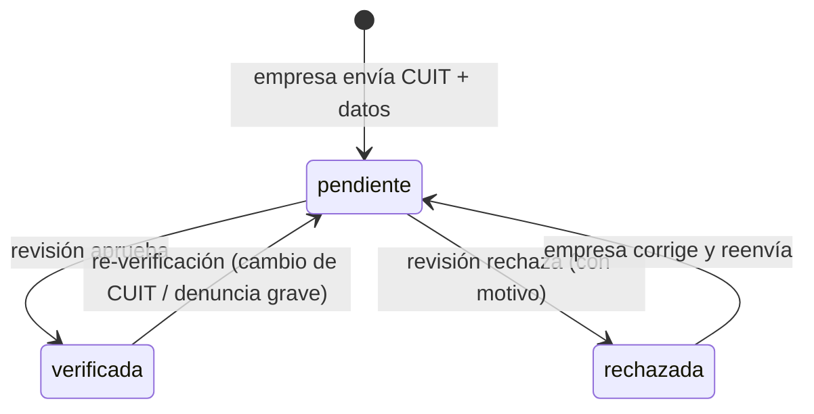
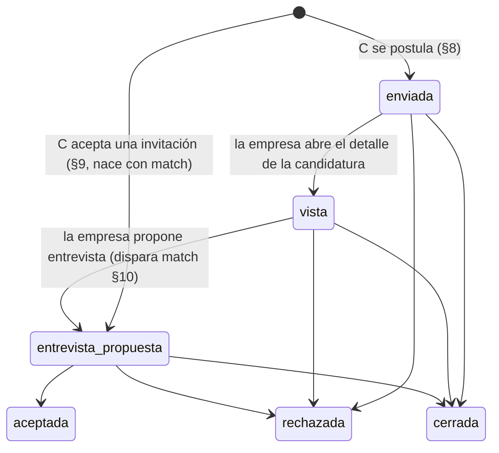

# TalentFlash Argentina — Flujos de UX

**Última actualización:** 2026-08-12
**Estado:** propuesta inicial — pendiente de aprobación del fundador

> Documento de referencia de todos los flujos de usuario del MVP (alcance §5 del SPEC).
> Se complementa con: `PRODUCT.md` (visión y alcance), `ARCHITECTURE.md` (stack y
> capas técnicas), `DATA_MODEL.md` (tablas y estados persistidos), `PRIVACY.md`
> (consentimientos, derechos, plazos legales), `SECURITY.md` (RLS, anti-abuso,
> URLs firmadas) y `ROADMAP.md` (fases). Las decisiones con impacto económico se
> registran en `COST_DECISIONS.md`.

**Convenciones de este documento**

- Roles: `C` = candidato, `E` = empresa/reclutador, `M` = moderador, `A` = administrador.
- Los nombres de pantalla van en `MayúsculaInicial` (p. ej. `PantallaMatch`); las rutas, en formato GoRouter (`/candidato/feed`).
- Todo número marcado **(propuesta a validar)** no es definitivo y requiere aprobación del fundador.
- Ningún flujo de IA toma decisiones automáticas: la IA sugiere, la persona confirma (SPEC §6).

---

## 1. Mapa de navegación general (rutas GoRouter de alto nivel)

Tres *shells* con navegación propia (candidato, empresa, admin) más rutas públicas. La estructura de guards y redirecciones se implementa en `lib/core/routing/` (ver `ARCHITECTURE.md`).

### 1.1 Rutas públicas (sin sesión)

| Ruta | Pantalla | Notas |
|---|---|---|
| `/` | Landing / splash | En Web: landing con propuesta de valor; en móvil: splash → redirección según sesión. |
| `/auth/login` | Login | Email+contraseña; enlaces a registro y recuperación. |
| `/auth/registro` | Selección de tipo de cuenta | Bifurca a onboarding C o E (§2, §3). |
| `/auth/recuperar` | Recuperación de cuenta | Email con enlace mágico de Supabase Auth. |
| `/ofertas/:id` | Detalle de oferta (público, solo Web) | Deep link compartible / SEO; CTA "Postularme" exige sesión. |
| `/legal/terminos`, `/legal/privacidad` | Documentos legales | Accesibles siempre, también sin sesión. |

### 1.2 Shell candidato (`/candidato/...`) — bottom navigation de 5 ítems

| Tab | Ruta | Pantalla raíz |
|---|---|---|
| Inicio | `/candidato/feed` | Feed de ofertas (§6.1) |
| Buscar | `/candidato/buscar` | Búsqueda y filtros (§7) |
| Postulaciones | `/candidato/postulaciones` | Lista con estados (§12) + tab "Guardadas" (§13) |
| Chat | `/candidato/chat` y `/candidato/chat/:conversacionId` | Conversaciones (§11) |
| Perfil | `/candidato/perfil` | Perfil, video, consentimientos, ajustes, cuenta |

Sub-rutas destacadas: `/candidato/video/grabar`, `/candidato/video/revisar`, `/candidato/ofertas/:id`, `/candidato/notificaciones`, `/candidato/ajustes/notificaciones`, `/candidato/ajustes/privacidad` (exportación/eliminación, §18).

### 1.3 Shell empresa (`/empresa/...`) — bottom navigation de 5 ítems

| Tab | Ruta | Pantalla raíz |
|---|---|---|
| Ofertas | `/empresa/ofertas` | Mis ofertas (estados: borrador/activa/pausada/vencida/cerrada) |
| Candidatos | `/empresa/candidatos` | Feed de candidatos (§6.2) |
| Postulaciones | `/empresa/postulaciones` | Pipeline por oferta (§12) |
| Chat | `/empresa/chat` y `/empresa/chat/:conversacionId` | Conversaciones (§11) |
| Empresa | `/empresa/cuenta` | Perfil de empresa, verificación CUIT, plan y facturación, equipo |

Sub-rutas destacadas: `/empresa/ofertas/nueva` (asistente IA, §5), `/empresa/ofertas/:id/editar`, `/empresa/candidatos/:id` (perfil de candidato), `/empresa/verificacion` (§3.2).

### 1.4 Shell admin (`/admin/...`) — solo Web, roles `M` y `A`

`/admin/verificaciones`, `/admin/moderacion` (§16), `/admin/denuncias`, `/admin/metricas`, `/admin/usuarios` (§17).

### 1.5 Guards de navegación (orden de evaluación)

1. `authGuard`: sin sesión → `/auth/login` (conserva ruta destino para redirigir después).
2. `roleGuard`: cada shell exige el rol correcto; un candidato que abre `/empresa/...` vuelve a su shell.
3. `onboardingGuard`: sesión sin onboarding completo → retoma el paso pendiente (§2/§3).
4. `verifiedCompanyGuard`: acciones de empresa sensibles (publicar oferta, invitar, chatear) exigen `empresa.estado_verificacion = verificada` (§3.2).
5. `consentGuard`: funciones que requieren un consentimiento no otorgado muestran la pantalla de consentimiento contextual en lugar de la función (§2.3).

---

## 2. Onboarding de candidato

**Objetivo:** de registro a perfil publicable en menos de 10 minutos, pidiendo lo mínimo (minimización de datos, `PRIVACY.md`). El video es **opcional** y se ofrece al final, nunca como bloqueo.

### 2.1 Pasos

1. **Registro** (`/auth/registro` → tipo "Busco trabajo"): email + contraseña o proveedor OAuth (Google/Apple). Verificación de email obligatoria antes de publicar el perfil.
2. **Declaración de mayoría de edad:** fecha de nacimiento; menores de 18 → bloqueo con mensaje claro y sin persistir datos adicionales (SPEC §9).
3. **Consentimientos granulares** (§2.3) — pantalla propia, antes de cargar cualquier dato de perfil.
4. **Datos básicos:** nombre, provincia/localidad/barrio (selector en cascada, mismo dataset que filtros §7), sector de interés (inicial: gastronomía y hotelería), disponibilidad y jornada preferida.
5. **Perfil profesional estructurado:** experiencias (puesto, lugar, duración), habilidades, idiomas, educación opcional. Cada sección es salteable; el "medidor de perfil" muestra qué falta sin culpabilizar.
6. **Presentación (opcional):** elegir entre video 20–30 s (§4), audio o texto. Botón "Lo hago después" siempre visible.
7. **Cierre:** resumen del perfil + estado "visible para empresas: sí/no" (visible solo si otorgó consentimiento B) → `/candidato/feed`.

### 2.2 Reglas

- Se puede abandonar en cualquier paso; el progreso se guarda y `onboardingGuard` retoma donde quedó.
- El perfil no aparece en el feed de empresas hasta: email verificado + consentimiento B otorgado + datos básicos completos.
- Sin CV tradicional obligatorio; la IA puede generar un CV a partir del perfil (función posterior al alta, SPEC §6).

### 2.3 Consentimientos granulares (tres decisiones separadas)

Pantalla con **tres toggles independientes, ninguno premarcado**, cada uno con texto breve + enlace "leer más" (texto legal completo en `PRIVACY.md`):

| ID | Consentimiento | Qué habilita | Si se rechaza |
|---|---|---|---|
| **A** | Tratamiento de datos personales | Uso de la cuenta (base mínima para operar) | No se puede crear la cuenta; se explica por qué. |
| **B** | Publicación de video y perfil ante empresas | Aparecer en feed/búsqueda de empresas; video visible | La cuenta funciona en "modo solo postulación": el candidato ve y se postula a ofertas, pero no es descubrible. |
| **C** | Funciones de IA (guion, teleprompter, mejoras de texto, subtítulos, coincidencias explicables) | Todas las asistencias IA del lado candidato | Todo funciona en modo manual; los puntos de entrada IA muestran "activá el consentimiento de IA" (consentGuard). |

- Cada consentimiento es **revocable** en `/candidato/ajustes/privacidad`; la revocación de B despublica perfil y video de inmediato; la de C desactiva las funciones IA sin borrar contenido ya creado por el usuario.
- Se persiste fecha, versión del texto y canal de cada otorgamiento/revocación (tabla de consentimientos en `DATA_MODEL.md`).
- Nunca se entrena ningún modelo con videos/audio/perfiles: eso requeriría un consentimiento **adicional y específico** que el MVP no solicita (SPEC §6).

---

## 3. Onboarding de empresa + verificación CUIT

### 3.1 Pasos

1. **Registro** (tipo "Busco personal"): email + contraseña; verificación de email.
2. **Consentimiento A** (tratamiento de datos del representante) — mismo patrón que §2.3.
3. **Datos de la empresa:** razón social, nombre de fantasía, CUIT, sector, tamaño, provincia/localidad, sitio web opcional.
4. **Datos del solicitante:** nombre, cargo, relación con la empresa.
5. **Envío a verificación** (§3.2) → mientras tanto puede completar el perfil de empresa y **redactar ofertas en borrador**, pero no publicarlas.
6. Verificada → elegir plan (Gratuito por defecto; planes según SPEC §7, precios siempre desde backend) → `/empresa/ofertas`.

### 3.2 Verificación CUIT — máquina de estados

| Estado | Qué puede hacer la empresa | UI |
|---|---|---|
| `pendiente` | Editar perfil, crear borradores de ofertas, ver la app en modo lectura. No publica, no invita, no chatea. | Banner persistente "Verificación en curso" con tiempo estimado. |
| `verificada` | Todo lo que permita su plan. | Sello "Empresa verificada" visible para candidatos en ofertas y chat. |
| `rechazada` | Solo ve el motivo del rechazo y el formulario de corrección/apelación. | Pantalla dedicada con motivo concreto y pasos para subsanar. |

**Proceso de revisión:** validación automática de formato y dígito verificador del CUIT en el cliente y en el backend; verificación de titularidad contra padrón público y revisión **humana** desde `/admin/verificaciones` (§17). En el MVP la aprobación es siempre humana; la IA solo pre-ordena la cola señalando inconsistencias (SPEC §6). SLA objetivo de revisión: 48 h hábiles **(propuesta a validar)**. Documentación adicional (constancia de inscripción) se sube por URL firmada (`SECURITY.md`).

---

## 4. Grabación de video (20–30 s) con teleprompter IA y alternativas

**Principio rector:** el video es opcional y nunca penaliza (SPEC §1, §10). Alternativas de igual jerarquía visual: **audio** (20–30 s) y **texto** (300–600 caracteres, **propuesta a validar**).

### 4.1 Flujo completo

1. **Entrada:** paso 6 del onboarding o `/candidato/perfil` → "Mi presentación".
2. **Elección de formato:** tres tarjetas (Video / Audio / Texto) con la misma prominencia.
3. **Preparación (opcional, requiere consentimiento C):** la IA propone un guion de 60–80 palabras a partir del perfil; el candidato lo edita libremente. Sin consentimiento C: pantalla de consejos estáticos + campo de guion manual.
4. **Teleprompter:** el guion se desliza sobre la vista de cámara; velocidad ajustable; puede ocultarse. Cuenta regresiva 3-2-1.
5. **Grabación:** límite duro de 30 s (corte automático con aviso previo a los 25 s); mínimo 20 s para publicar (por debajo se ofrece regrabar o pasar a audio/texto). También se admite **subir** un archivo existente (se valida duración y formato; escaneo de uploads según `SECURITY.md`).
6. **Revisión previa a publicar (obligatoria):** reproducción completa + subtítulos generados automáticamente (Cloudflare Stream + corrección IA) **editables línea por línea**. Nada se publica sin acción explícita del candidato.
7. **Decisión:** `Publicar` (exige consentimiento B) · `Regrabar` · `Guardar como borrador` · `Descartar`.
8. **Publicación:** upload directo a Cloudflare Stream con URL firmada; estado `procesando` → `publicado` con notificación in-app. El video anterior queda reemplazado (se conserva 7 días por si quiere volver, **propuesta a validar**; luego borrado definitivo según retención de `PRIVACY.md`).

### 4.2 Reglas

- **Regrabaciones ilimitadas** antes de publicar; reemplazos del video publicado limitados a 3 por día para contener costos de encoding **(propuesta a validar; impacto en `COST_DECISIONS.md`)**.
- Subtítulos **siempre** presentes en el video publicado (WCAG AA, §20); el candidato puede corregirlos después desde el perfil.
- La transcripción alimenta la búsqueda de empresas solo si hay consentimiento B.
- Prohibido en toda la cadena: análisis de emociones, de personalidad o reconocimiento facial (SPEC §6). El video se reproduce; no se "analiza" al candidato.

---

## 5. Creación de oferta con asistente IA ("de descripción informal a oferta estructurada")

### 5.1 Flujo

1. `/empresa/ofertas/nueva` → dos caminos: **"Contámelo con tus palabras"** (asistente IA) o **"Formulario completo"** (manual). Ambos terminan en el mismo formulario.
2. **Camino IA:** campo libre ("Busco moza para turno noche en Palermo, pago $X más propinas, con experiencia…") → Edge Function llama a Claude (modelo económico por defecto, ver `ARCHITECTURE.md` y `COST_DECISIONS.md`) → borrador estructurado con **cada campo marcado como `detectado` o `faltante`**.
3. **Formulario estructurado:** la empresa revisa campo por campo. Los campos inferidos por IA se muestran con distintivo "sugerido por IA — revisá" y nunca se publican sin confirmación humana.
4. **Validación:** no se puede publicar con campos obligatorios vacíos (lista §5.2); errores señalados campo a campo con mensajes comprensibles.
5. **Vista previa** exactamente como la verá el candidato → `Publicar` (exige empresa `verificada` + cupo de ofertas activas del plan) o `Guardar borrador`.
6. **Post-publicación:** editar (cambios sustanciales re-notifican a postulantes), pausar, cerrar, duplicar. Estados de oferta: `borrador → activa → (pausada ⇄ activa) → vencida | cerrada`. El vencimiento es automático en la `fecha_vencimiento`.

### 5.2 Campos obligatorios (SPEC §5 — sin excepciones)

Sueldo o rango salarial (en ARS) · modalidad contractual · relación de dependencia o monotributo · jornada completa o parcial · días y horarios · presencial/híbrido/remoto · provincia · localidad · barrio (cuando aplique: obligatorio si localidad = CABA, **propuesta a validar**) · experiencia requerida · disponibilidad · beneficios · fecha de vencimiento.

---

## 6. Feeds

### 6.1 Feed de ofertas (candidato) — `/candidato/feed`

- **Tarjeta de oferta:** puesto, empresa (+sello verificada), barrio/localidad, salario o rango **siempre visible**, jornada, modalidad, chips de compatibilidad explicable ("Coincide: zona, experiencia en salón"). Acciones: abrir, guardar (§13), postularse (§8).
- **Orden:** recencia + compatibilidad **explicable** (zona, sector, jornada, experiencia declarada). Cada tarjeta con coincidencia muestra el "por qué"; no existen puntajes ocultos (SPEC §6). Las **ofertas patrocinadas** aparecen claramente rotuladas "Patrocinada" y nunca camufladas (SPEC §7).
- Pull-to-refresh; paginación infinita; las ofertas ya postuladas muestran su estado en la tarjeta.

### 6.2 Feed de candidatos (empresa) — `/empresa/candidatos`

- Visible solo para empresas `verificada`. Muestra únicamente candidatos con consentimiento B.
- **Tarjeta de candidato:** video (reproducción con subtítulos) o presentación texto/audio, nombre de pila, zona, sector, disponibilidad, chips de coincidencia explicable con la oferta activa seleccionada. Sin foto obligatoria, sin edad, sin datos sensibles.
- Selector superior "candidatos para: [oferta activa]" que ajusta coincidencias y filtros.
- Acciones: ver perfil completo, **invitar** (§9), guardar en lista corta.
- El orden jamás usa "popularidad" ni likes (SPEC §6).

---

## 7. Búsqueda y filtros

Pantalla única con buscador de texto + panel de filtros (bottom sheet en móvil, sidebar en Web). Misma taxonomía para C y E; los datasets de geografía y sectores viven en el backend (ver `DATA_MODEL.md`).

| Filtro | Valores | Notas |
|---|---|---|
| Geografía | Provincia → Localidad → Barrio (cascada) | Barrio disponible para CABA y partidos del GBA cargados; multi-selección de barrios. |
| Sector | Gastronomía y hotelería (MVP); luego comercio, ventas, logística, depósitos | Taxonomía versionada en backend. |
| Jornada | Completa · Parcial | |
| Modalidad | Presencial · Híbrido · Remoto | |
| Salario | Rango min–max en ARS | Slider + campos numéricos; filtra contra el rango publicado. |
| Extra candidato | Solo empresas verificadas (fijo: siempre) · con fecha de vencimiento lejana | |
| Extra empresa | Disponibilidad · experiencia declarada · con video/audio/texto | Nunca filtros por características sensibles (SPEC §6). |

- Filtros activos como chips removibles arriba de los resultados; contador de resultados en vivo.
- La última combinación de filtros se persiste por usuario; búsquedas guardadas con alerta opcional (notificación §14) quedan para post-MVP **(propuesta a validar)**.

---

## 8. Postulación

1. Desde el detalle de oferta: botón `Postularme` (deshabilitado con motivo si la oferta está vencida/pausada o ya se postuló).
2. **Hoja de confirmación:** resumen de lo que verá la empresa (perfil + presentación) + mensaje breve opcional (280 caracteres, **propuesta a validar**). Si tiene consentimiento C, la IA puede sugerir el mensaje; edición libre.
3. `Confirmar` → estado `enviada` (§12) + confirmación visual + la tarjeta pasa a "Postulada".
4. **Retirar postulación:** posible mientras no esté `aceptada`; la empresa ve "postulación retirada".
5. **Anti-spam:** límite de postulaciones diarias por candidato (p. ej. 20/día, **propuesta a validar**; racional en `SECURITY.md` — rate limiting).

---

## 9. Invitación de empresa

1. Desde feed de candidatos o perfil: `Invitar a [oferta activa]` (elige la oferta si tiene varias).
2. Mensaje opcional breve; la invitación siempre referencia una **oferta concreta** (transparencia; sin "contactos fríos" sin contexto).
3. El candidato recibe notificación (§14) y ve la invitación en `/candidato/postulaciones` (pestaña "Invitaciones") con la oferta completa.
4. Respuestas: `Aceptar` → crea postulación en estado `entrevista propuesta` **y dispara match** (§10) · `Rechazar` (opcionalmente con motivo anónimo agregado) · sin respuesta → expira a los 14 días **(propuesta a validar)**.
5. Cupo de invitaciones según plan de la empresa (valores por plan: `COST_DECISIONS.md`, **propuesta a validar**).

---

## 10. Match recíproco

**Definición:** hay match cuando **ambas partes expresaron interés sobre la misma oferta**. Dos caminos lo disparan:

| Camino | Interés del candidato | Interés de la empresa |
|---|---|---|
| 1 | Se postuló a la oferta (§8) | La empresa propone una entrevista (la candidatura pasa a `entrevista propuesta`, §12) |
| 2 | Acepta la invitación (§9) | Ya existía: la invitación misma |

**Efectos inmediatos:** se crea la conversación (§11) y ambas partes reciben notificación.

**PantallaMatch:** modal de celebración sobria (respetando "reducción de animaciones", §20) con: oferta, ambas partes, botón primario `Abrir chat` y secundario `Después`. Sin mecánicas de gamificación ni contadores de "likes" (SPEC §6).

---

## 11. Chat

### 11.1 Regla de habilitación (decisión)

> **El chat entre un candidato y una empresa existe únicamente si hay match recíproco (§10).** Como aceptar una postulación y aceptar una invitación son exactamente los dos caminos del match, la regla operativa es una sola: **sin match, no hay chat**. Ninguna parte puede iniciar mensajes fríos. Cada conversación queda vinculada a una oferta concreta.

### 11.2 Comportamiento

- Realtime (Supabase Realtime, ver `ARCHITECTURE.md`); texto en MVP; sin adjuntos en la primera versión **(propuesta a validar)**.
- Indicadores: enviado/entregado/leído; el estado de la postulación asociada es visible en el encabezado de la conversación.
- Acciones en el encabezado: ver oferta, ver perfil, **denunciar** y **bloquear** (§15). El bloqueo cierra la conversación para ambas partes.
- Si la postulación pasa a `rechazada` o `cerrada` (p. ej. al cerrarse o vencer la oferta), el chat queda en **solo lectura** con aviso claro (historial accesible; nadie pierde evidencia de lo conversado).
- Guardrails de seguridad: aviso fijo la primera vez ("Nunca envíes dinero ni datos bancarios…"), detección de patrones de estafa como **señal para moderación humana**, nunca borrado automático (SPEC §6).

---

## 12. Estados de postulación

> **Decisión aprobada el 12-08-2026 por el fundador:** el candidato **ve** cuando su candidatura fue vista. Los estados visibles para el candidato son exactamente seis: `enviada`, `vista`, `entrevista propuesta`, `aceptada`, `rechazada`, `cerrada`.

| Estado | Quién lo dispara | El candidato ve | Notifica |
|---|---|---|---|
| `enviada` | C al postularse (§8) | "Enviada" | Push a la empresa (según preferencias, §14) |
| `vista` | Automático cuando el recruiter abre el detalle de la candidatura | "Vista" (estado visible + badge in-app; transparencia, sin ansiedad de 'visto' en chat) | **Solo in-app** (estado visible + badge). Push desactivada por default, configurable en preferencias (§14) — aprobado el 12-08-2026 por el fundador |
| `entrevista propuesta` | E propone entrevista / sistema cuando C acepta una invitación (§9) → **match + chat** (§10) | "Entrevista propuesta" + acceso al chat | Push al candidato (según preferencias) |
| `aceptada` | E confirma la contratación (C puede confirmar también) | "¡Aceptada!" | Push a ambos (según preferencias) |
| `rechazada` | E en cualquier momento pre-aceptación; motivo **elegido por un humano** de lista + texto opcional | Mensaje respetuoso, con motivo si la empresa lo indicó | Push al candidato (según preferencias) |
| `cerrada` | Sistema, cuando la oferta se cierra o vence sin resolución de la candidatura | "Cerrada" | Push al candidato (según preferencias) |

- Registro de `vista`: se persiste únicamente el hecho y el momento en que el recruiter abre el detalle de la candidatura. **Nunca se registra ni se infiere atención, interés, emoción ni calidad de visualización** (aprobado el 12-08-2026 por el fundador).
- La IA **nunca** cambia estados ni sugiere rechazos automáticos (SPEC §6). Puede resumir postulaciones para la empresa, con etiqueta "resumen generado por IA".
- Vista empresa: pipeline Kanban por oferta con drag & drop entre columnas (equivalente accesible por teclado/menú, §20).
- Historial de transiciones persistido con autor y fecha (auditoría, `DATA_MODEL.md`).

---

## 13. Ofertas guardadas

- Ícono "guardar" en tarjeta y detalle; lista en `/candidato/postulaciones` → pestaña "Guardadas".
- Aviso in-app cuando una oferta guardada está por vencer (72 h antes, **propuesta a validar**) o fue cerrada.
- Guardar es privado: la empresa no lo ve ni lo usa como señal (evita el anti-patrón "likes como índice", SPEC §6).

---

## 14. Notificaciones (push + in-app)

Canal push: FCM (Android/Web) + APNs (iOS), orquestadas desde el backend (SPEC §4). Centro in-app: `/candidato/notificaciones` y equivalente empresa, con badge en el ícono.

| Evento | Destinatario | Push por defecto | Deep link |
|---|---|---|---|
| Nueva postulación | E | Sí | Pipeline de la oferta |
| Candidatura vista (`vista`) | C | **No** — solo in-app (estado visible + badge); push configurable en preferencias, desactivada por default | Detalle de postulación |
| Cambio de estado de postulación (`entrevista propuesta` / `aceptada` / `rechazada` / `cerrada`) | C | Sí (según preferencias) | Detalle de postulación |
| Invitación recibida | C | Sí | Detalle de invitación |
| Match | Ambos | Sí | PantallaMatch → chat |
| Mensaje de chat | Ambos | Sí (agrupado por conversación) | Conversación |
| Oferta guardada por vencer | C | No (solo in-app) | Detalle de oferta |
| Verificación de empresa resuelta | E | Sí | `/empresa/verificacion` |
| Video procesado / error de video | C | No (solo in-app) | Perfil |
| Resolución de denuncia | Denunciante | Sí | Centro de notificaciones |
| Avisos de cuenta (exportación lista, eliminación programada) | Titular | Sí | Ajustes de privacidad |

**Regla aprobada el 12-08-2026 por el fundador:** el cambio a `vista` se muestra **in-app** (estado visible + badge, §12); su push está **desactivada por default** y puede activarse en `/…/ajustes/notificaciones`; los demás cambios de estado sí notifican según las preferencias del usuario. Esta tabla y la de §12 quedan alineadas bajo esa regla.

**Preferencias** (`/…/ajustes/notificaciones`): toggle por categoría (mensajes, postulaciones — incluye el opt-in de push para `vista`, desactivado por default —, matches, avisos de cuenta — los avisos de cuenta y seguridad no se pueden desactivar), horario silencioso opcional (por defecto 22–08, **propuesta a validar**), permiso del SO solicitado **en contexto** (tras la primera acción que genera notificaciones, no en el primer arranque).

---

## 15. Denuncia y bloqueo

### 15.1 Denunciar

- Disponible en: perfil de candidato, perfil/oferta de empresa, mensaje de chat, video.
- Flujo: `Denunciar` → categoría (contenido inapropiado · estafa/pedido de dinero · discriminación · acoso · oferta falsa/engañosa · suplantación de identidad · otro) → descripción opcional → confirmación "Recibimos tu denuncia".
- La denuncia entra a la cola de moderación (§16). El denunciante recibe notificación al resolverse (sin detalle de la sanción, por privacidad del denunciado).
- Denunciar **no** bloquea automáticamente; la pantalla de confirmación ofrece "¿Querés también bloquear?".

### 15.2 Bloquear

- Efecto inmediato y bidireccional: no se ven perfiles ni ofertas, chats en solo lectura cerrada, no llegan invitaciones/postulaciones del bloqueado.
- Lista de bloqueados gestionable en ajustes de privacidad; desbloquear requiere confirmación.
- El bloqueado **no** es notificado.

---

## 16. Cola de moderación humana (flujo del moderador)

Rol `M`, acceso solo a `/admin/moderacion` y `/admin/denuncias`. Cada acción queda en el audit log (`SECURITY.md`).

1. **Entrada a la cola:** denuncias de usuarios (§15), señales automáticas (escaneo de uploads, patrones de estafa en chat, texto de oferta con términos prohibidos) y muestreo aleatorio de contenido nuevo **(propuesta a validar)**.
2. **Priorización asistida por IA (con supervisión humana, SPEC §6):** la IA clasifica severidad sugerida y agrupa duplicados; el orden final y toda decisión son del moderador.
3. **Pantalla de revisión:** contenido denunciado con contexto (oferta/perfil/hilo de chat relevante), historial de denuncias previas del denunciado, categoría, notas de otros moderadores.
4. **Acciones:** `Desestimar` (con motivo) · `Quitar contenido` (video/oferta/mensaje, con notificación y motivo al autor) · `Advertir` usuario · `Suspender` cuenta (temporal, con duración) · `Escalar a admin` (casos legales, suplantación, riesgo de daño).
5. **SLA objetivo:** severidad alta 4 h, media 24 h, baja 72 h **(propuesta a validar)**.
6. **Apelación:** el sancionado puede apelar una vez desde la notificación; la apelación la revisa un moderador distinto **(propuesta a validar)**.

---

## 17. Panel admin

Rol `A` (incluye capacidades de `M`). Solo Web, con MFA obligatorio (`SECURITY.md`).

| Sección | Ruta | Contenido |
|---|---|---|
| Verificaciones | `/admin/verificaciones` | Cola de CUIT pendientes (§3.2): datos declarados vs. padrón, documentación adjunta, aprobar/rechazar con motivo obligatorio. |
| Moderación / Denuncias | `/admin/moderacion`, `/admin/denuncias` | Vista de §16 + escalamientos + gestión de apelaciones. |
| Métricas | `/admin/metricas` | Registros, activación (perfil completo, video publicado), ofertas activas, postulaciones, matches, conversaciones, conversión por plan, embudo de verificación, salud de moderación (volumen/SLA). Sin datos personales innecesarios en dashboards. |
| Usuarios | `/admin/usuarios` | Búsqueda de cuentas, estado, historial de sanciones, suspensión/reactivación. Todo acceso a un perfil queda registrado (registro de accesos administrativos, SPEC §9). |

---

## 18. Exportación de datos y eliminación de cuenta

Ambos flujos en `/…/ajustes/privacidad`. Plazos legales y detalle de retención en `PRIVACY.md` (ley 25.326 / AAIP).

### 18.1 Exportación

1. `Exportar mis datos` → re-autenticación (contraseña o biometría).
2. Job asíncrono en backend genera paquete (perfil, postulaciones, mensajes, consentimientos, video original si existe).
3. Notificación "Tu exportación está lista" → descarga por URL firmada válida 7 días **(propuesta a validar)**.
4. Límite: 1 exportación en curso por vez.

### 18.2 Eliminación de cuenta

1. `Eliminar mi cuenta` → pantalla que explica **exactamente** qué se borra, qué se retiene por obligación legal (p. ej. registros de facturación de empresas) y los plazos.
2. Ofrecer alternativas claras pero sin fricción oscura: "pausar visibilidad" (revocar consentimiento B) o exportar antes de borrar. Un solo paso de alternativa, nunca laberintos.
3. Confirmación fuerte: re-autenticación + escribir "ELIMINAR" (o confirmación biométrica).
4. **Efecto inmediato:** cuenta desactivada; perfil, video y ofertas despublicados; chats anonimizados para las contrapartes ("Cuenta eliminada"); suscripciones activas canceladas vía `PaymentProvider` (empresas: aviso previo de que perderán el plan).
5. **Período de gracia de 30 días (propuesta a validar):** se puede reactivar iniciando sesión. Cumplido el plazo, borrado definitivo e irreversible de datos personales y video (incluido Cloudflare Stream), conservando solo lo legalmente exigido en forma disociada.
6. Email de confirmación al iniciar y al completar el borrado.

---

## 19. Estados vacíos, de error y offline

### 19.1 Estados vacíos (siempre: ilustración liviana + texto claro + CTA)

| Superficie | Mensaje (tono es-AR) | CTA |
|---|---|---|
| Feed de ofertas sin resultados | "Todavía no hay ofertas en tu zona." | Ampliar filtros / activar aviso |
| Búsqueda sin resultados | "Nada con esos filtros." | Chips sugeridos para relajar filtros |
| Postulaciones vacías | "Acá vas a seguir tus postulaciones." | Ir al feed |
| Guardadas vacías | "Guardá ofertas para verlas después." | Ir al feed |
| Chat vacío | "Cuando tengas un match, chateás acá." | Ver cómo funciona el match |
| Feed de candidatos vacío (empresa) | "Aún no hay candidatos para estos filtros." | Ajustar filtros / revisar oferta |
| Pipeline sin postulaciones | "Tu oferta está activa; las postulaciones aparecen acá." | Compartir oferta |

### 19.2 Errores

- Patrón único: qué pasó + qué puede hacer el usuario + acción de reintento. Nunca códigos crudos ni jerga ("Error 500").
- Errores de formulario: campo a campo, texto + ícono (no solo color, §20), foco movido al primer error.
- Errores de pago (empresa): estado claro de la suscripción + reintento + contacto; jamás bloquear el acceso a datos ya creados por un pago fallido durante el período de tolerancia (SPEC §8).
- Fallos de IA (timeout/límite): degradar a modo manual con aviso amable; la función nunca queda "rota" — siempre existe el camino sin IA.
- Fallo de subida de video: conservar la grabación local y ofrecer reintentar; no obligar a regrabar.

### 19.3 Offline

- Banner persistente "Sin conexión" no bloqueante.
- Lectura desde caché: feed ya cargado, detalle de postulaciones, conversaciones recientes (estrategia de caché en `ARCHITECTURE.md`).
- Escrituras: mensajes de chat en cola con estado "pendiente" y reenvío automático; postulaciones y publicaciones de oferta requieren conexión (acción crítica, feedback inmediato honesto).
- La grabación de video funciona 100% offline; solo la subida requiere red.
- Skeleton screens durante cargas (respetando reducción de animaciones).

---

## 20. Accesibilidad WCAG AA aplicada por flujo

Base transversal (todas las pantallas): contraste AA, objetivos táctiles ≥ 48 dp, soporte completo de `Semantics` en Flutter para screen readers (TalkBack/VoiceOver), navegación por teclado en Web (orden lógico de foco, foco visible), texto escalable hasta 200 % sin pérdida de contenido, `MediaQuery.disableAnimations` respetado (reducción de animaciones), nunca color como único portador de significado, mensajes de error comprensibles (SPEC §10).

| Flujo | Requisitos específicos AA |
|---|---|
| Onboarding (§2–3) | Formularios con labels programáticos y errores anunciados por el lector; consentimientos como controles nativos con estado anunciado; progreso comunicado ("paso 3 de 6"). |
| Video (§4) | Video **nunca obligatorio** (alternativas texto/audio de igual jerarquía); subtítulos siempre y editables; transcripción disponible como texto; teleprompter con velocidad y tamaño ajustables; cuenta regresiva con aviso sonoro y háptico; controles de grabación accesibles por lector. |
| Oferta con IA (§5) | Contenido sugerido por IA anunciado como tal; validaciones asociadas a cada campo (`aria-describedby` en Web); vista previa navegable por encabezados. |
| Feeds (§6) | Tarjetas como un solo nodo semántico con acciones internas alcanzables; reproducción de video no automática con sonido; etiqueta "Patrocinada" leída por el lector. |
| Búsqueda (§7) | Filtros operables por teclado; chips removibles con label completo ("Quitar filtro: Palermo"); resultados anunciados ("42 ofertas"). |
| Postulación (§8) e Invitación (§9) | Hojas de confirmación con foco atrapado y botón de cierre; resultado anunciado en vivo (region `polite`). |
| Match (§10) | Animación de celebración omitida con reducción de animaciones; el modal es descartable y todo su contenido, legible por lector. |
| Chat (§11) | Mensajes nuevos anunciados; entrada de texto con label; estados enviado/leído con texto accesible, no solo íconos; historial navegable. |
| Pipeline (§12) | Alternativa al drag & drop: menú "mover a estado…" operable por teclado y lector. |
| Notificaciones (§14) | Preferencias como switches con estado anunciado; el centro in-app replica todo lo push (no depender de un solo canal sensorial). |
| Denuncia/moderación (§15–16) | Formularios simples, categorías como radio buttons; confirmaciones textuales claras. |
| Privacidad (§18) | Confirmaciones de borrado sin dependencia exclusiva de gestos; textos legales en lenguaje llano con versión completa enlazada; plazos comunicados en texto. |
| Errores/offline (§19) | Banners con rol de alerta; reintentos accesibles; skeletons sin parpadeo (riesgo fotosensible). |

**Criterio de aceptación transversal:** cada feature del MVP incluye en su *definition of done* una pasada de accesibilidad (analizador de contraste, prueba con lector de pantalla, prueba de teclado en Web). Se detalla en `ARCHITECTURE.md` (calidad) y `ROADMAP.md` (fase MVP).

---

## Preguntas abiertas para el fundador

1. Plazos y límites marcados **(propuesta a validar)**: SLA de verificación (48 h) y de moderación, gracia de eliminación (30 días), límites anti-spam (20 postulaciones/día, 3 reemplazos de video/día), expiración de invitaciones (14 días), validez de la exportación (7 días).
2. ¿Barrio obligatorio solo para CABA o también para partidos del GBA con dataset disponible?
3. ¿Las búsquedas guardadas con alertas entran al MVP o quedan para Crecimiento (`ROADMAP.md` fase 6)?
4. ¿Adjuntos en chat (p. ej. CV en PDF) en MVP o post-MVP?
